# Compiler ILP

This lesson discusses some of the techniques used by compilers to achieve greater ILP.
Improving instruction scheduling and reducing the number of instructions are the basic goals of compiler ILP.

- can compilers help improve ipc?
    - limited ilp
        - dependence chains: instr that depend on each other, limits ilp
    - hw has limited window into program
        - independent instrs far apart: runs out of rob space before seeing independent instr

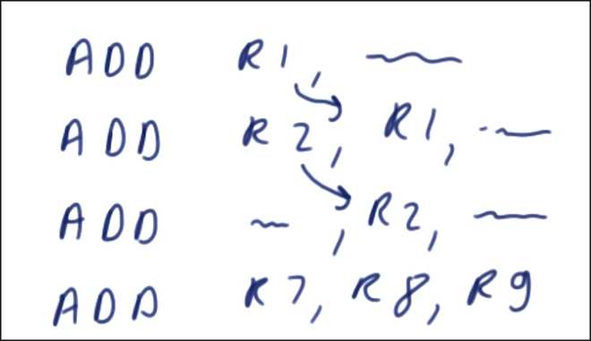

## Tree Height Reduction

- first approach forms dependence chain for r8

Tree height refers to the dependence chains in a list of instructions.
Tree height reduction is re-grouping the calculations in an instruction list to reduce the dependencies.
- 2 instr that are indep now with reduction (3 -> 2 cycles)
This method only works for calculations that are associative.

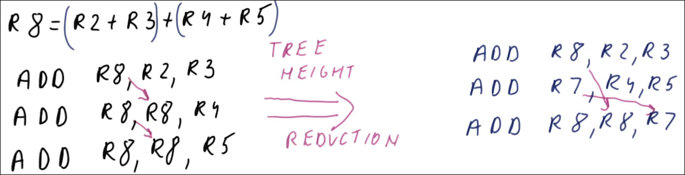

- figure out expression of orig, then rewrite
    - add up 4 nums (r1 r2 r4 r6), subtract 3 nums (r3 r5 r7 after adding them up, else it'd be raw if individually sub)
- draw deps

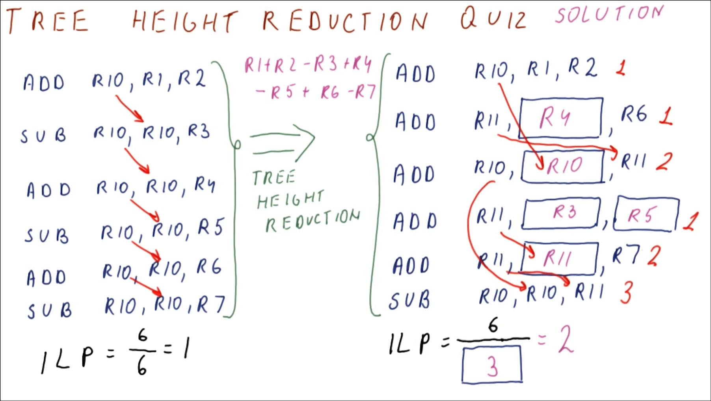

## Making Independent Instructions Easier to Find

- real ps'er can only see so many instr ahead, techniques to enhance

Techniques to make independent instructions easier to find:

- Instructions Scheduling
- Loop Unrolling
- Trace Scheduling

## Instruction Scheduling

- diff than tomasulo scheduler where hw reorders instr in diff arrangement than compiler, now compiler tries to do same thing

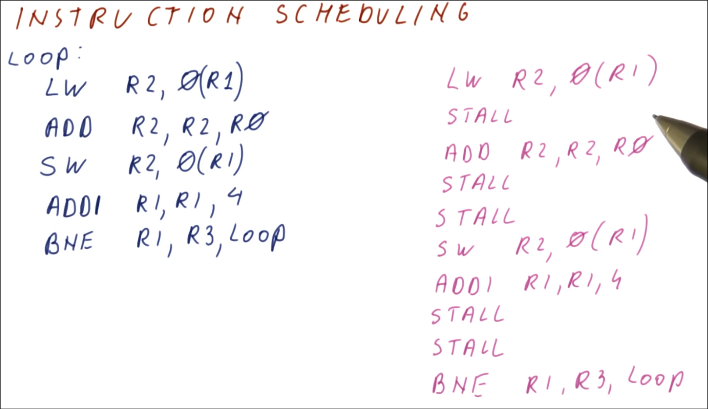

- assume ps'er only looks at next instr
- load r1 to r2
    - stalls to get r1 from cache
- add r0 to r2
    - stalls to run it
- store res into r1
- move mem addr 4 places forward
    - stalls to run it
- compare ptr to r3 (i.e. end of arr ptr), jump back to loop if not equal

When there is a dependency between instructions, there is often a need for the processor to stall between instructions. 
A stall can be replaced with an independent instruction, as long as the program produces the correct result. 
Sometimes the correct result requires modifying additional instructions.

The modifications can include -- changing the address offsets and changing the destination registers.

- Address offset changes occur when the instruction moves relative to an address fetch.
- Destination register changes occur when an instruction move causes a register to be re-written earlier in the program than expected.

- compiler tries to find smth that doesn't depend on the load, and moves the instr to eliminate stall
    - addi (war dep)
    - have to fix the offset for sw bc it's getting the +4 version of r1 (fix to -4)
    - in place of the stall after lw, so counts as 1 cycle for the add after addi
        - sw still needs 2 cycles from the add r2
    - need 2 cycles in between addi and bne originally done with stalls, now there's instrs in between

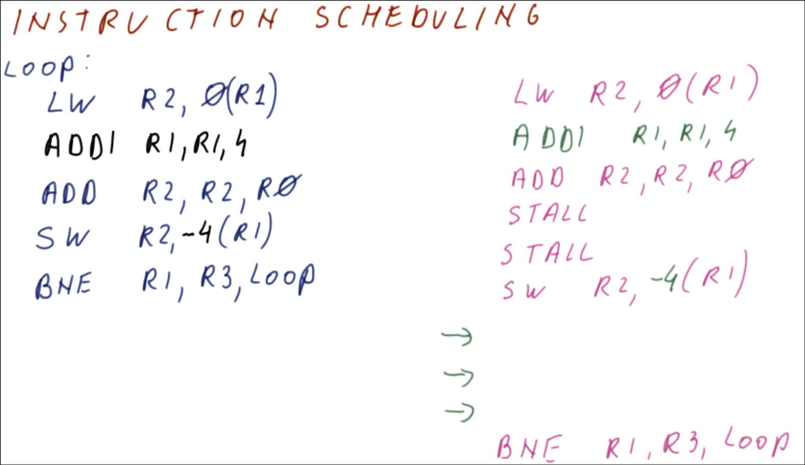

- 2 stall points

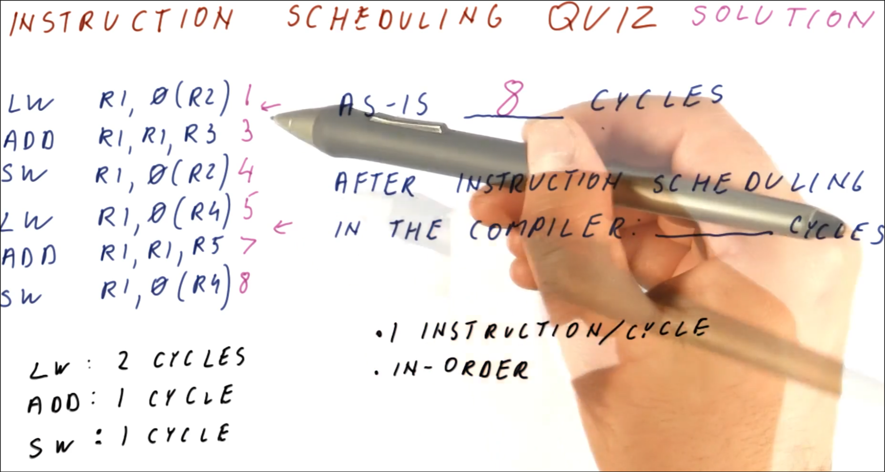

- find instr in the first stall that doesn't violate deps
    - instr 4 lw, have to rename r1
    - arrange so that any deps on lw has instr in between instead of stalls, could also swap the sw r1 and add r10

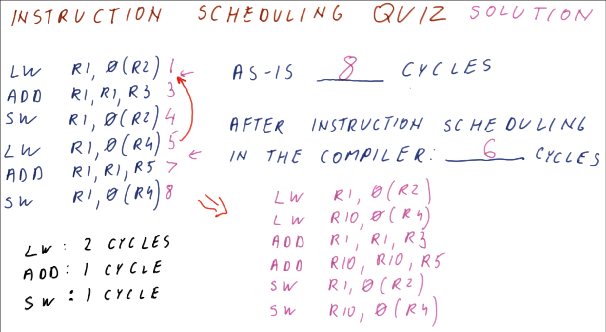

## Scheduling and If Conversion

- before if conversion with a cond, hard to reschedule instr across separate control flows, easy within, to fill stalls

If conversion helps in two ways:

1. It reduces the number of branches.
    - Both branches of the if statement are executed using predication (branch free code)
2. It allows for greater flexibility in instruction scheduling.
    - Since all branches are executed instructions can be moved with greater ease, which will reduce the number of stalls.
    - helps compiler make better schedule for ps'er

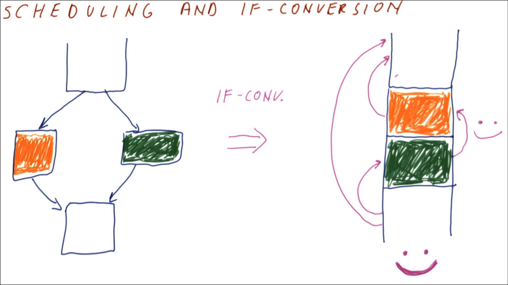

## If Convert a Loop

- say every op takes 2 cycles to do (3 stall cycles total)
    - sw and addi no stalls, sw writing to mem
- with rescheduling one stall, change offset for sw

- with a new iteration, a new predicate introduced, and continues for every iteration

A loop cannot be converted using the If conversion, but it can be improved using loop unrolling.

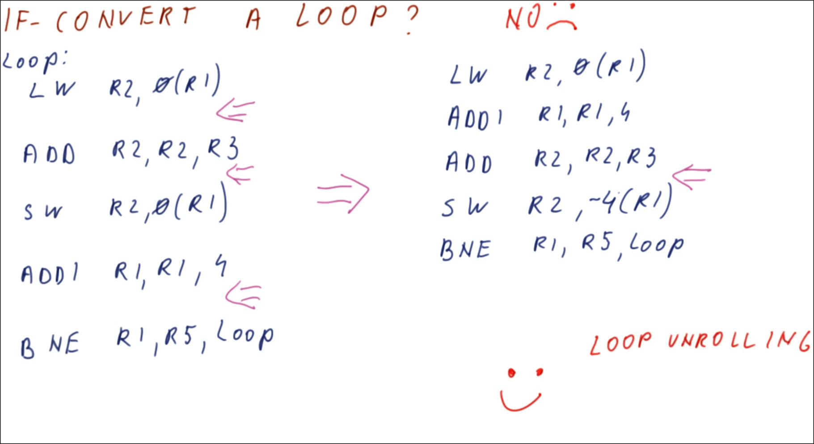

## Loop Unrolling

Loop unrolling creates a loop with fewer iterations by having each iteration do the work of two or more iterations. This will reduce the number of branches that need to be executed and it increases the number of instructions that can be considered during the instruction scheduling.

## Loop Unrolling benefits

- unrolling once
    - each iteration doing work of 2 iterations, adjust the counter
        - could unroll more than once
    - take orig work, copy twice, adjust second copy so it does second iteration's worth of work + loop count for 2 iterations

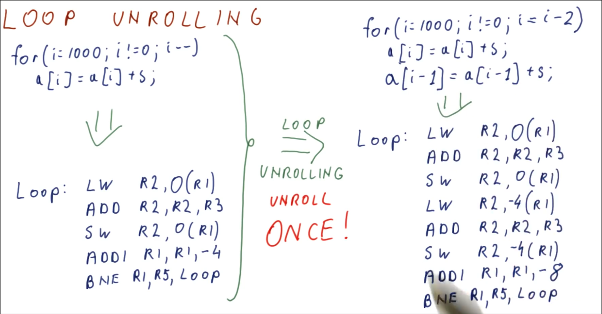

The benefits of loop unrolling:

- Reduces the overall number of instructions that need to be executed for the loop.
    - This is done by reducing the loop overhead.
        - overhead to proceed to next iteration (addi + bne)
    - iron law (num of instr reduced)

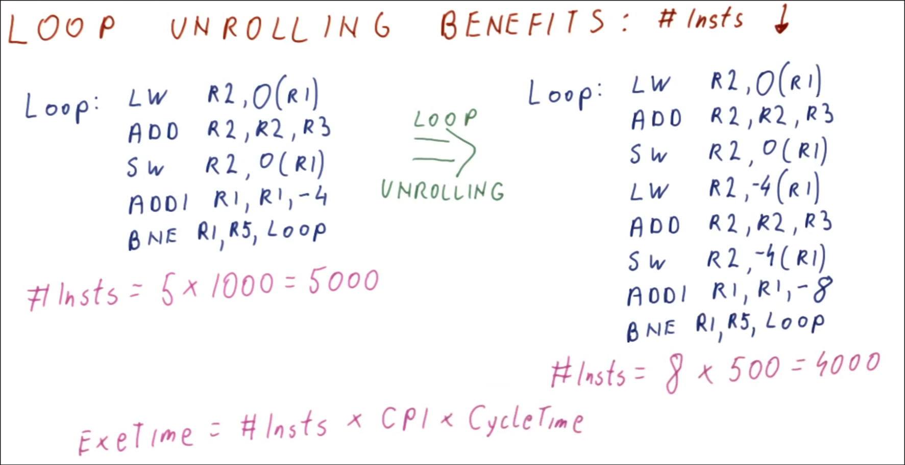

- Reduces the CPI. 
    - Once the loop is unrolled, the scheduler has more flexibility. leading to a better CPI.
    - for orig seq + rescheduled
        - with perfect branch pred, do load for next iter at the bne instr too
            - count that as the cycle for cpi
        - for after scheduling, no dep on lw and addi on r1 bc it was updated in prev iteration
            - r1 acting as a ptr here

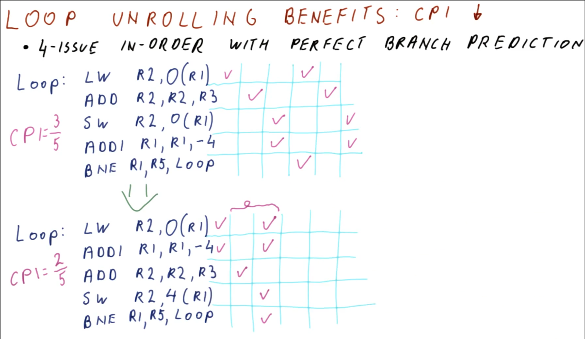

- for unrolling once
    - sw and lw is war dep for r2
    - cpi of 5/8 = 0.62 (cpi not improved)

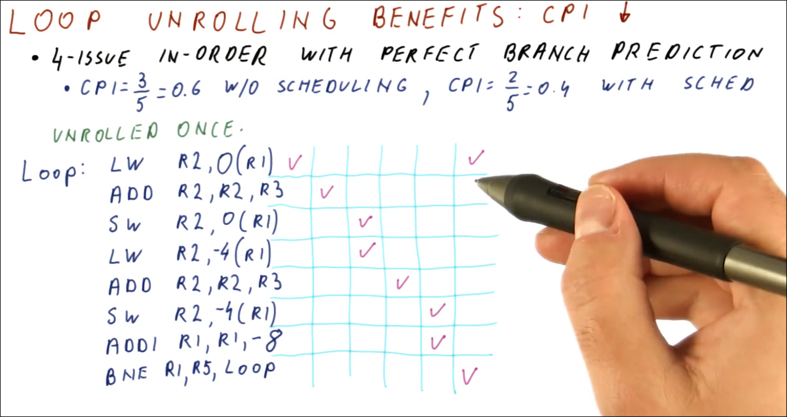

- for unrolling once + sched
    - second lw, can't store val in r2 so use r10
    - store to 0(r1) and -4(r1), r1 got decremented by 8 so fix offset (add 8 to orig offsets)
    - in the second iteration, can't do both lw bc already have 4 instr
- if unrolled 3 times
    - 4 lws same cycle, 4 adds, 4 sw
    - reduce num of instr and cpi

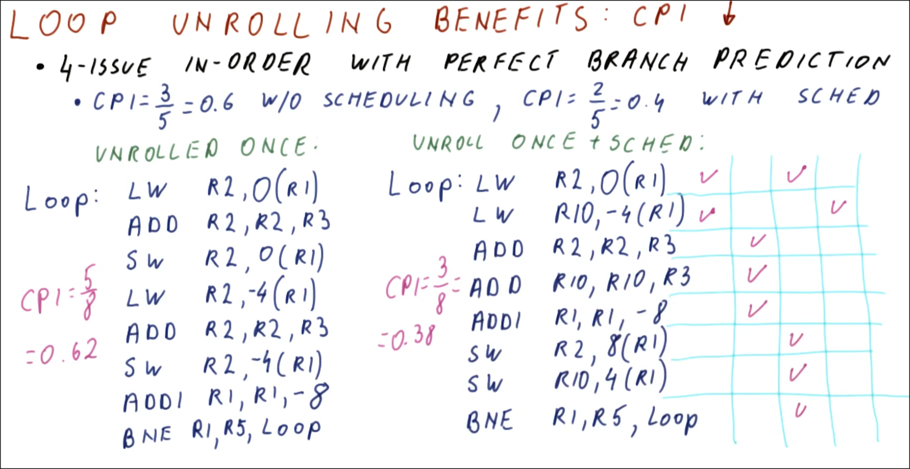

- summing an array

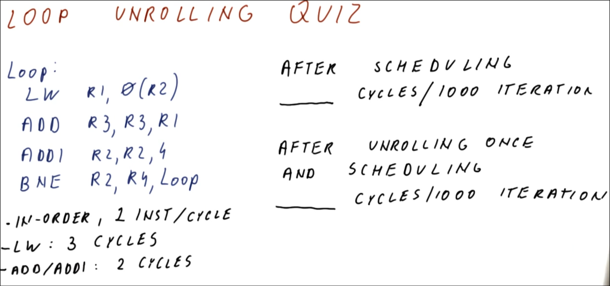

Before scheduling there are three stall cycles.

After Scheduling: 5000 cycles / 1000 iterations
- 5 * 1000

After scheduling there is one stall cycle per iteration (ADD must wait for one cycle so LW can complete). The instruction order is:

```
Loop:

LW R1, 0(R2)
ADDI R2,R2,4
stall
ADD R3,R3,R1
BNE R2,R4,Loop
```

After unrolling once and scheduling: 3500 cycles / 1000 original iterations
- 7 * 500

After unrolling and scheduling the instruction order is:

Loop:

LW R1,0(R2)
LW R8,4(R2)
stall
ADD R3,R3,R1
ADDI R2,R2,8
ADD R3,R3,R8
BNE R2,R4,Loop

The loop after scheduling looks like this, with six instructions per (new) iteration. Note that the first ADD stalls for one cycle waiting for the first load, so it takes seven cycles to execute these six instructions.

Our unrolling saved 1000 cycles by removing instructions (we execute only 3000 instructions instead of 4000)
- addi bne * 1000 = 2000 vs addi bne * 500 = 1000

and 500 cycles by allowing better scheduling that reduces the total number of stall cycles from 1000 (one stall in each original iteration) to 500 (one stall in each new iteration that does the work of two original iterations).
    
## Unrolling Downside

The downsides of unrolling include:

- Code bloat
    - larger code size, 1-3 replicated, 4 is the branch
- What if the number of iterations are unknown at the start of the loop?
    - while loop, doing two iters at a time but what if we need to exit earlier than the entire unroll?
- What if the number of iterations are not a multiple of N?
    - exit in the middle?

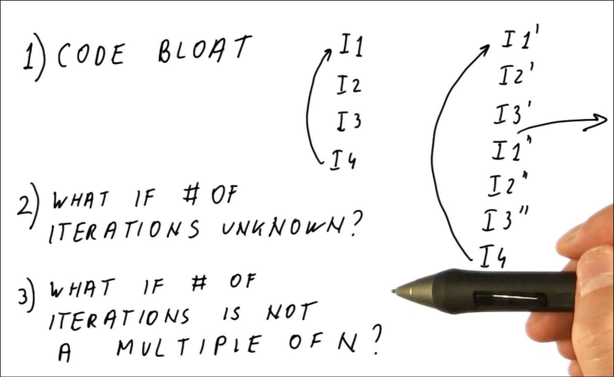

There are solutions to these problems - but they will not be discussed in this class.

## Function Call Inlining

Inlining for functions is similar to loop unrolling.

Inlining involves removing the function call and just replacing it with the body of the function.
- removes func call/ret, func params, pop params from stack in func, copying res to return reg

Obviously this is only an improvement for small functions. This will eliminate 
- the function call
- the return statement
    - reduces instr
- and allow for improved instruction scheduling.
    - work from func can be moved around, depending on deps
    - reduces cpi

- decrease exe time
    - smaller func has more overhead so inlining has greater improvement

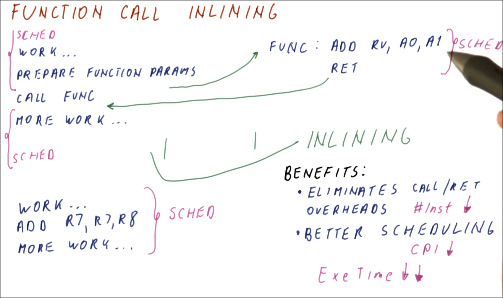

## Function Call Inlining Downside

Inlining Downside:

- Code bloat. The more inlining, the more code bloat.
    - i.e. same func called multiple times, inlining effectively puts same set of instrs in multiple places
        - 10 instr + 1 ret + 2 calls = 13 instr becomes
        - 10 + 10 instrs = 20 instrs, func body replicated

Inlining should be done on functions that are small.
- more likely to offset additional inlining instrs against the func call overheads
    - larger func means replication likely results in more code than the orig calls did

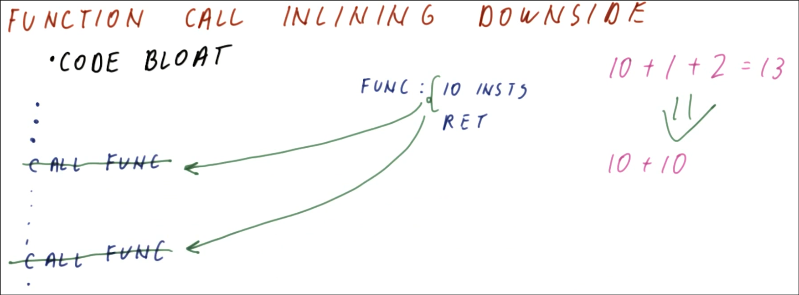

- assume 1 instr at a time
- can't do scheduling with no inlining
    - lw, res in cycle 3, can do call in cycle 2

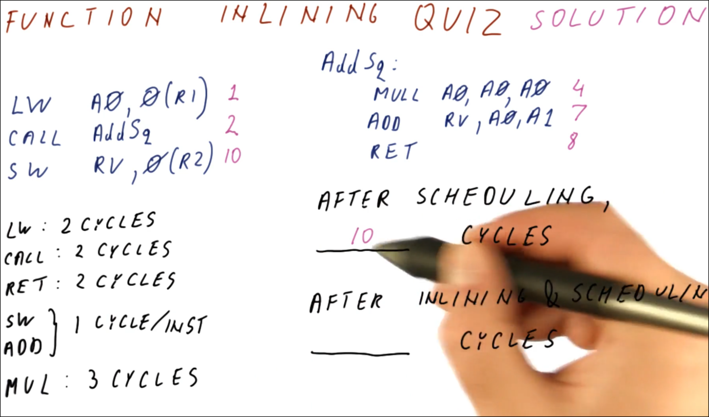

- inlining takes mull add and replaces the call, ret eliminated too
    - still can't do scheduling

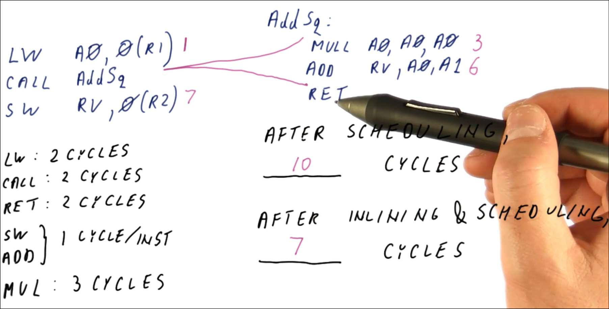

## Other IPC Enhancing Compiler Stuff

There are other methods for enhancing IPC, they are not discussed in this course.

- Software Pipelining
    - helps schedule loops without greatly increasing code size but gets effect of unrolling
- Trace Scheduling
    - if conversion on steroids, find common paths

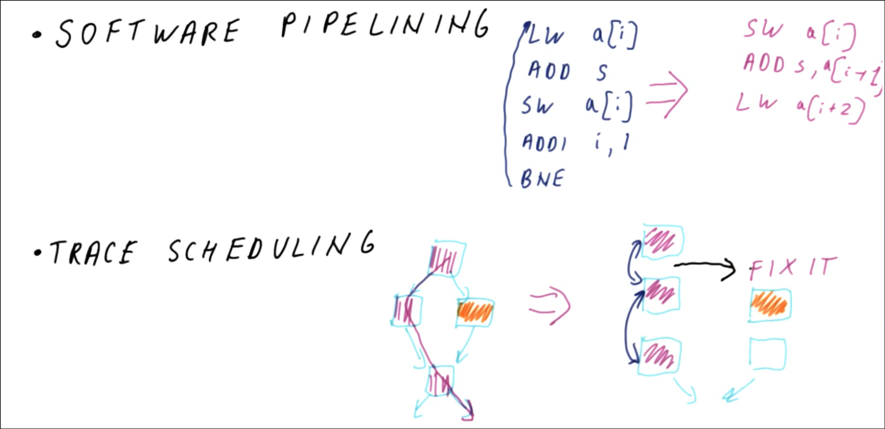