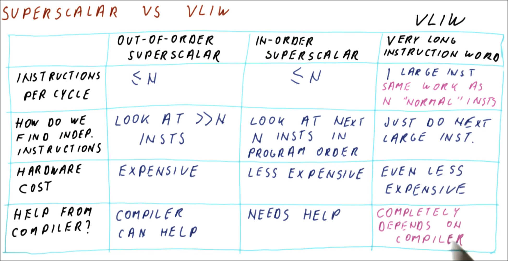
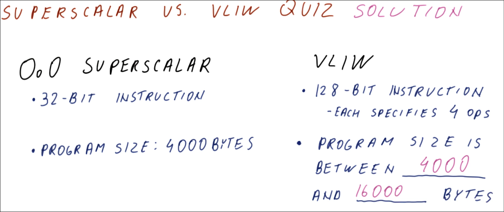
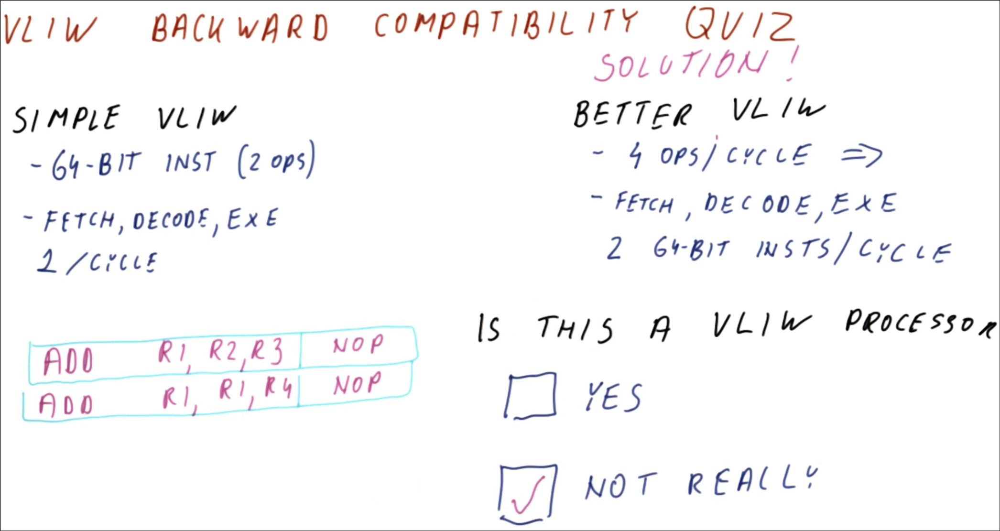
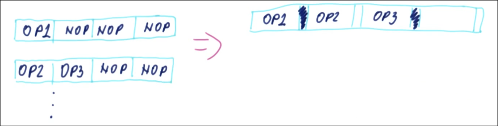
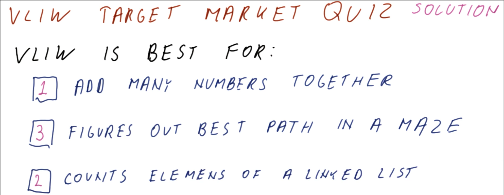

# VLIW

VLIW processors are another way to improve performance.
These processors work best with regular tasks- such as loops and array manipulations.

- don't try identify ilp on their own, follow what compiler says

## More than 1 IPC

Processors that can issue more than 1 instruction per cycle:

- Out of Order Superscalar
  - It can issue multiple instructions per cycle
  - It can look at a lot of instructions at a time for scheduling
  - Very expensive - with many reservation stations, etc.
  - A compiler can help with improving IPC
- In Order Superscalar
  - It can issue multiple instructions per cycle
  - It can look at fewer instructions at a time for scheduling than OOO processor
  - It is less expensive that OOO processor
  - It needs help from a compiler to improve IPC
- Very Long Instruction Word (VLIW)
  - It executes 1 big instruction per cycle
  - It does not do instruction scheduling, it just executes the next large instruction
  - It is the least expensive of the three listed
  - It really requires a good compiler

- ipc
  - trying to do same work per cycle
    - superscalar trying to do more than 1 simple instr/cycle, vliw 1 instr that's same work as N of former
- find indep instr
  - ooo: window of more than N instr to find the N it needs to execute
  - inorder: next n in pgrm order
  - vliw: next large instr
- hw cost
  - ooo: expensive to look at many instr to find the N
  - inorder: less expensive
  - vliw: even less expensive
- help from compiler
  - ooo: compiler can help
  - inorder: need compiler to put indep instr consecutively
  - vliw: depends on compiler

- ooo: hw intensive, don't need help
- inorder: reduce hw cost, need compiler help
- vliw: low hw cost, completely depends on compiler

## Superscalar Vs. VLIW

- each vliw instr with 4 ops similar to 1 superscalar instr
- if we can package 4 superscalar instrs into 1 vliw instr, pgrm size the same
- if all superscalar instr depend on each other, can only fit 1 op into the vliw instr and fill with 3 noops
  - ops in vliw instr indep of each other

A superscalar processor:

1. Gets multiple instructions
2. Checks for dependencies
3. Then sends instructions to the execution units for parallel execution when it can.

A VLIW Processor:

1. The compiler looks for dependencies
2. If there are dependencies it loads them into separate instruction words. This can lead to much larger number of bytes for a program in VLIW.

## VLIW: The Good and the Bad

Good:

- The compiler does the work and this program is run over and over.
  - Thus, the compiler can take the time to find good instruction scheduling.
    - compiler ran once, pgrm ran many times
    - in ooo ps'er, time to figure out schedule is added to pgrm exe time
- The hardware is simpler than for Superscalar
- It can be energy efficient
  - hw less to do per executed instr
- It works well on “regular code” such as loops and arrays.
  - sweeping thru arrays, matrix mult

Bad:

- Latencies of instructions are not always the same
  - cache miss (compiler can plan for load to have cache hit, but miss occurs)
- Many applications are irregular
  - ptrs, ai apps
- Code bloat
  - lots of noops to prevent dependent ops in same instr

- 64 bit instr, 1 at a time, each instr equivalent to 2 ops
- want 4 ops a cycle -> fetch decode exe 2 of those instr a cycle
- in vliw ps'er, compiler tells which ops can be done in parallel by putting them in same instr
  - do 1 instr per cycle, guarantee we're doing indep ops
  - only guarantees 2 ops in same instr are done in parallel for simple vliw
  - if better vliw tries to do 2 instr per cycle, could violate deps(would have to check for deps, same as superscalar ps'er)

## VLIW Instructions

- VLIW instructions have all the usual ISA opcodes
- Fully support predication
  - relies on compiler to expose parallelism, one of ways is via predication for instr scheduling
- Require many registers because of the scheduling optimizations
- Branch hints because the compiler needs to tell the hardware its predictions (helps branch predictors)
- VLIW instruction compaction - instead of using NOPs for empty instruction slots there are stops. This reduces the number of instructions required, thus reducing code bloat.
  - actual vliw instr might have stop bits instead of noops

## VLIW Examples

Examples of VLIW processors:

- Itanium Processor - too complicated, not good with irregular code
  - tons of isa features for compiler scheduling
    - complicated hw
- DSP (digital signal psing) Processors - usually have excellent performance and energy efficient
  - floating point work, regular loops (typically small amount of work in each iteration), lots of iterations
  - code where compiler can figure pgrm out

- linked list would have load instrs -> cache misses -> negatively affect compiler scheduling

