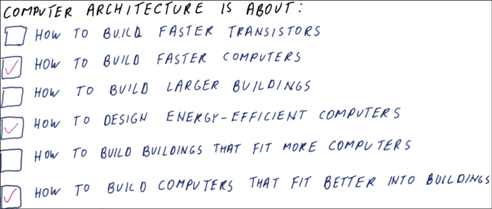
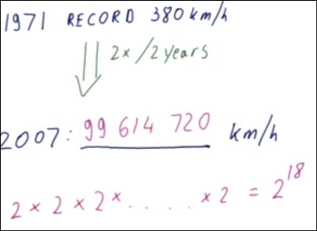
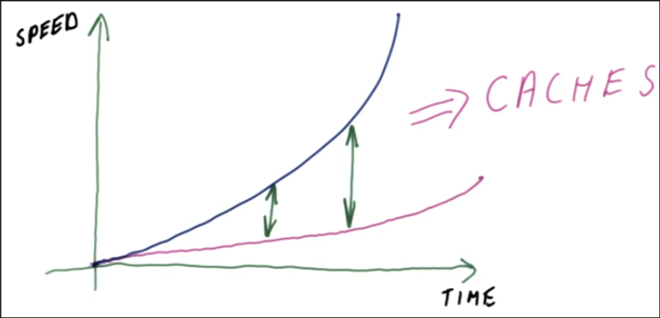
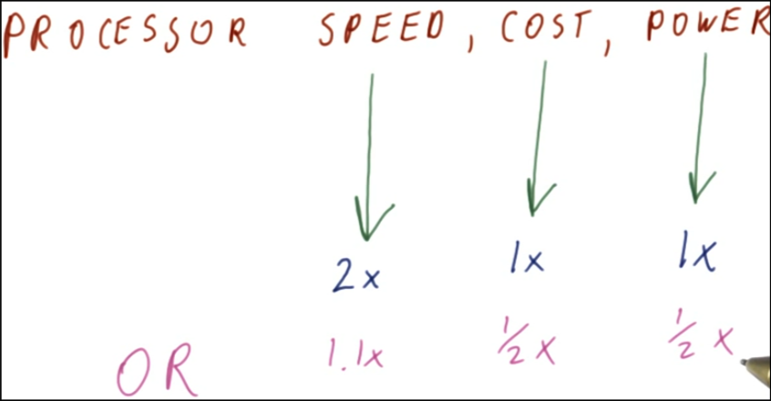
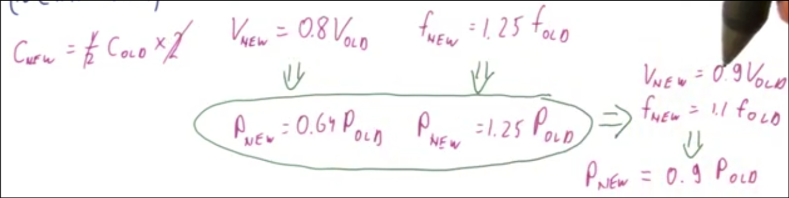
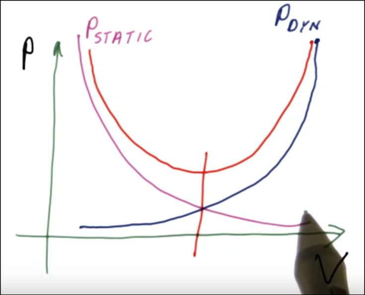
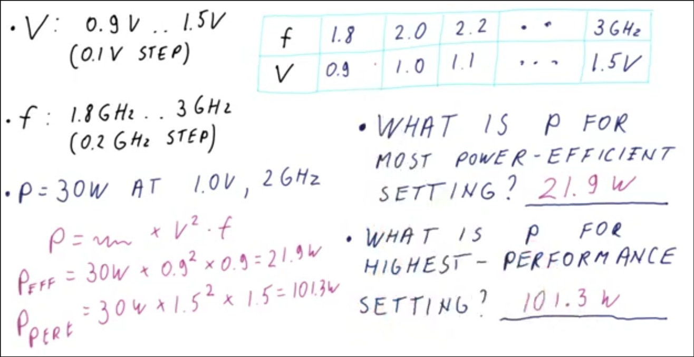
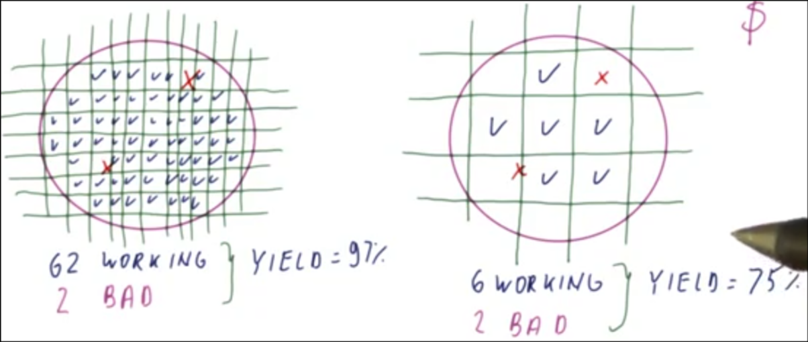
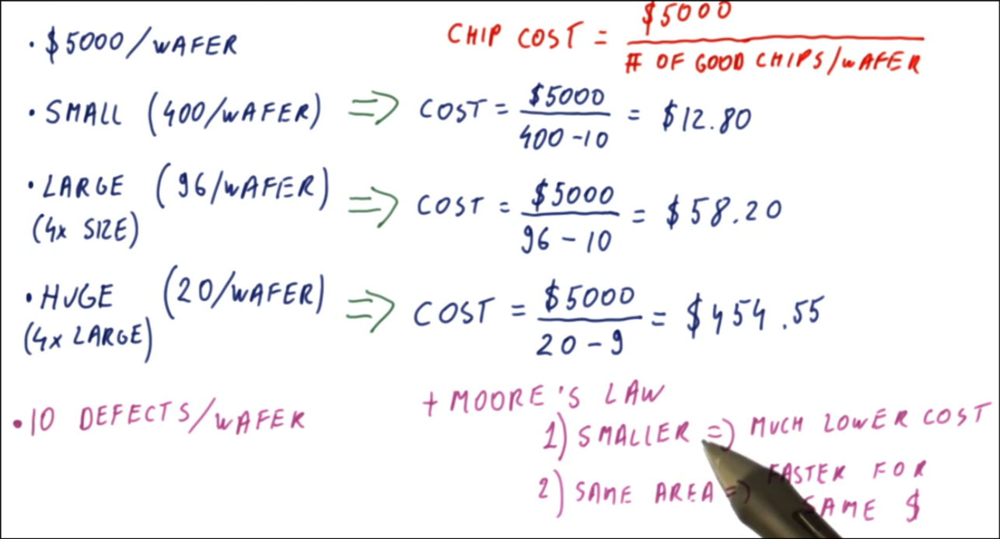
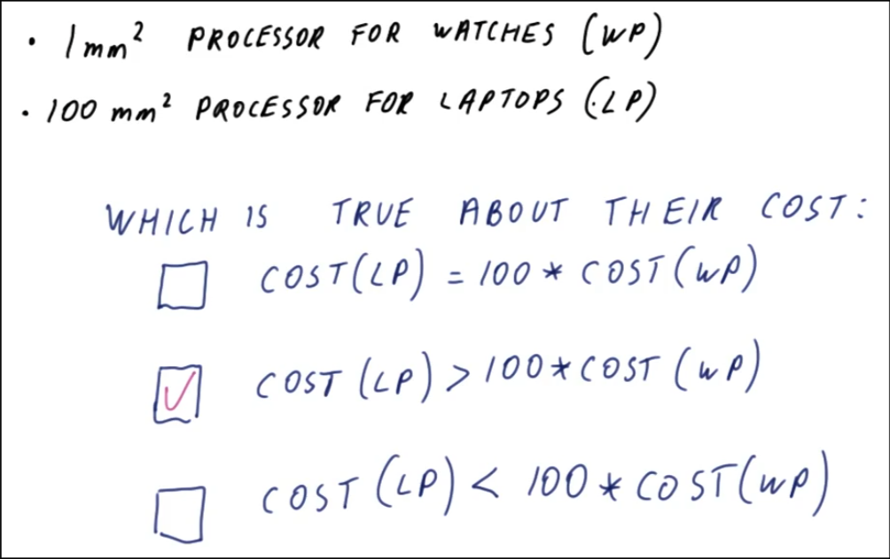

# HPCA Introduction

This lesson introduces computer architecture and it's importance to computer performance. It also discusses some basic concepts of computer design such as; Moore's Law, power considerations, and fabrication costs. These concepts are just as important as performance when making design decisions in computer architecture.

What is computer architecture? Designing a computer that is well suited for it purpose.

Why do we need computer architecture?

1. Improve performance (faster, smaller, cheaper),
2. Improve capabilities of the computer (new things possible).

Take improvements in fabrication tech and circuit designs, translate to comp arch, achieve those things

## Computer Trends

Computer architects must be aware of computer trends to anticipate and design for the future because of the time it takes to develop new products.

If current technology and parts is used the product will be obsolete by the time it is ready for the market place.

### Moore's Law

Every 18 - 24 months techniques are developed that allow twice as many transistors to be placed within the same chip area. By extension it is expected that:

1. Processor speed doubles every 18 - 24 months.
2. Energy per operation consumption is halved every 18 - 24 months.
3. Memory capacity is doubled every 18 - 24 months.

### Memory Wall

While improvements have been seen in the number of instructions per second and in the memory capacity (2x/2 yrs), memory latency has only improved 1.1 times every two years.

The result is processors have gotten much faster but memory devices have not. Difference grows based on the the exponential curve.

The hinderance to improved performance used to be processor speed, now it is memory latency, this is known as the memory wall. Caches are used to mitigate the effects of the memory wall.

## Processor Performance

Processor Performance is usually discussed in terms of speed.

- Fabrication costs (more powerful ps'ers in inexpensive devices) and 
- Power consumption (longer battery life) must also be considered when discussing performance.

Given technology can provide the metrics, which do you want for computer?

- consider perf, battery life, weight, cost

### Power Consumption

- Dynamic Power: consumed by activity in a circuit.
- Static Power: consumed when powered on but idle.

Active Power = Dynamic Power

    P = 1/2 * C * V^2 * freq * alpha

- C = capacitance (proportional to chip area)
    - if chip area halves, and add 2 of them, it's double the perf same footprint
- V = power supply voltage
    - smaller transistors helps lower power supply voltage
- f = clock frequency (typically ghz)
    - smaller transistors are faster -> increase clock freq
- alpha = activity factor (what portion of ps'er active in clock cycle)

- 2 cores instead one, lower voltage but higher freq, and lower power consumption

Static Power - prevents lowering the power supply voltage too much.

- As voltage decreased - power leakage increases.
    - higher voltage = pushing charges across capacitors faster, lower = threshold to turn on transistors reduced so higher leakage
- There is an optimal point for the voltage somewhere in between, where there is maximum voltage for minimal leakage.

- most power efficient = lowest freq and voltage, highest on other end
    - power proportional to frequency and voltage squared, reducing freq also reduces voltage

### Fabrication Cost

Take wafer, print circuitry (fixed cost), cut up wafer into chips, put into package with pins, and test. 12 in wafer, thousands in manufacturing.

Fabrication Cost include the cost of manufacturing and the cost of defective parts. The larger the die the higher the percentage of defective parts.

Larger chips = smaller yield = lower working percentage. Chips are round, so some lost too.

    Fabrication Yield = number of working chips / number of chips on the wafer

With Moore's Law -

1. drastically reduce the cost of a processor by making the same processor with a smaller area (something that couldn't be done before, cell phone).
2. Use same area to make a better processor (HPC ps'ers) for same cost.

Larger = smaller yield

