# HPCA Metrics and Evaluation

This lesson shows methods for measuring improvements to a system. These methods are important to the computer architect during the decision making process because they show which designs will yield the best performance.

Performance usually refers to the speed of the processor. Speed can be broken down into two aspects of speed:

- Latency (start to done): how much time does it take to go from the start to the finish
- Throughput (#/sec): how many tasks can be completed in one time unit.

Throughput is NOT always equal to 1/Latency, think about pipelining if assembly line. Not 0.25 cars/hr, 12 min/step so 5 steps in 1 hr

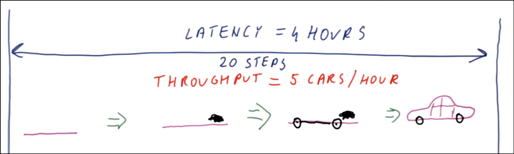

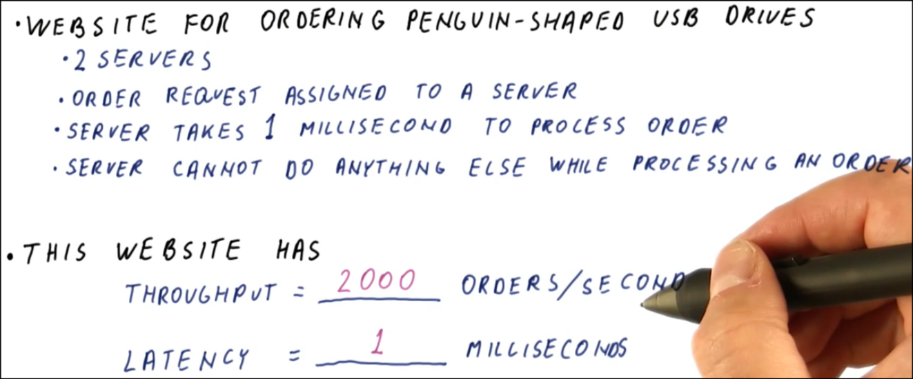

## Comparing Performance

Performance can be compared using speedup.

Speedup is defined as "X is N times faster than Y". X is new, Y is old.

    Speedup: N = Speed(X) / Speed(Y) = Throughput(X) / Throughput(Y) = Latency(Y) / Latency(X)

*Note the difference when using Latency

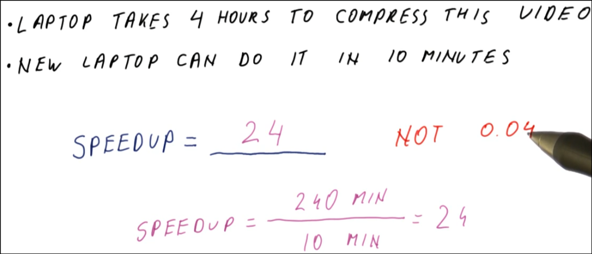

- Speedup < 1: The performance has gotten worse with the newer version. The degradation is because of worse performance.
- Speedup > 1: The performance has gotten better with the newer version. The improvement is through shorter execution time or with Higher Throughput.

Performance is proportional to 1/latency, proportional to throughput

## Measuring Performance

Performance ~ 1/Execution time

When comparing performances of different processors, a standard/benchmark task should be used. This will lead to a standard execution time for the given task for the processor.

Actual user workloads can be many programs, not representative of other users, how do you get workload data?

### Benchmarks

Benchmarks are standard tasks for measuring processor performance. A benchmark is a suite of programs that represent common tasks.

Agreed upon programs and input data for perf measurements, each representative of some types of apps.

#### Types of Benchmarks

- Real Applications - most realistic, most difficult to set up - used for real machine comparisons.
- Kernels (prototypes) - most time consuming part of an application (i.e. a loop), is still difficult to set up
- Synthetic (design studies) - similar to kernels, but simpler to compile
- Peak performance (marketing) - i.e. IPC

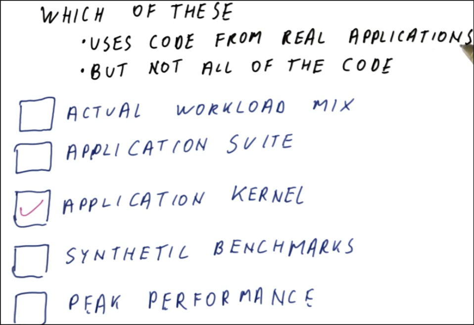

#### Benchmark Standards

There are benchmark organizations that create the standard benchmarks.

Take from user groups, experts in academia, manufacturers.

## Summarizing Performance

Summarize performance using the average execution time, don't use on ratio of times.

If Speedup is compared to Speedup; the Geometric mean, NOT the average, must be used.

    Geometric mean = (Product of the terms)^(1/Number of terms)

- Ratio of average execution times (1.5): Use to compare total wall-clock time, showing how much faster a machine finishes the entire batch of programs combined.
- Geometric mean of speedups (1.456): Use to compare relative performance, giving each program equal weight regardless of how long it takes to run.
- Never use the arithmetic mean on speedup ratios (1.63), as it skews the results and changes depending on which machine is chosen as the baseline.

## Iron Law of Performance

The Iron Law of Performance is:

    CPU Time = # of Instructions in the Program * Cycles per Instructions * Clock cycle Time

All three aspects are important in decision making in computer architecture

- \# of Instructions in the Program: is effected by the algorithm, the compiler used, and/or the instruction set used.
- Cycles per Instructions: is affected by the instruction set and/or the processor design
- Clock cycle Time: is affected by processor design, circuit design, and/or transistor physics
- Computer architects influence the instruction set and the processor design.

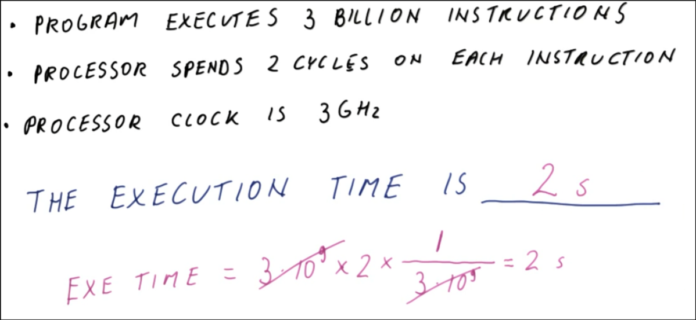

### The Iron Law for Unequal Instruction Times

- diff num of cycles per instr

    CPU Time = [Sum of(Inst/Program * cycles/Inst)] * Time/cycle

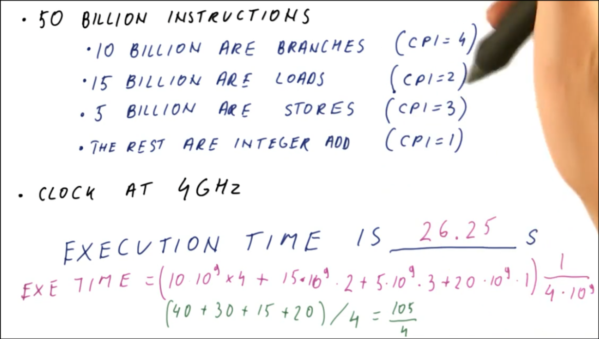

## Amdahl's Law

Used for measuring speedup when only a fraction of the system is improved.

    Speedup = 1 / ((1 - Frac of Enhancement) + (Frac Enhancement / Speedup Enhancement))

Frac of Enhancement = % of original execution time that is affected by enhancement.

Use Iron Law to plug in and find execution time.

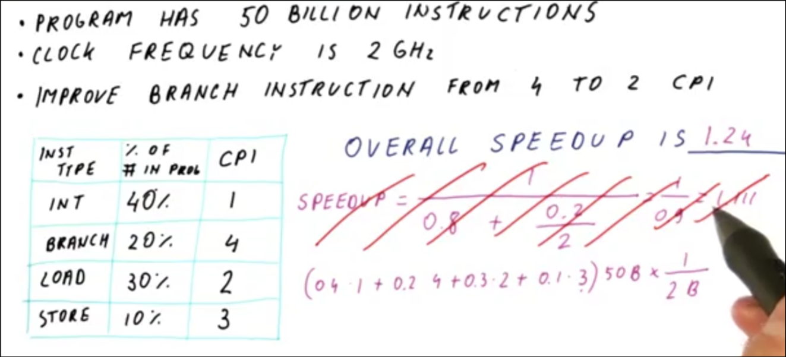

### Amdahl's Law Implications

Use Amdahl's law to determine which design decisions will yield the best system.

Make the Common Case Fast: small improvements for a large percentage of the system are better than large improvements on a small percentage of the system.

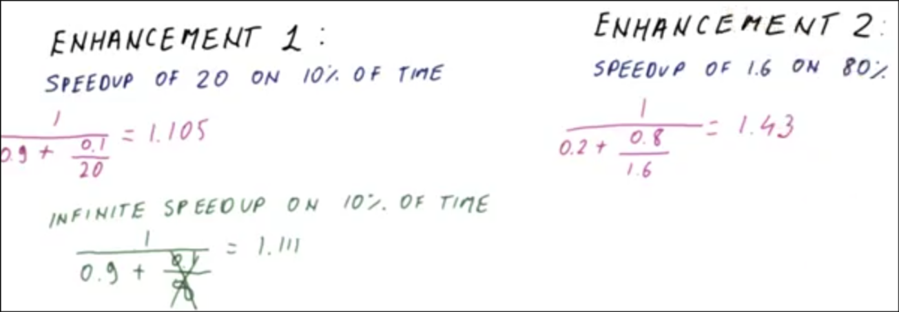

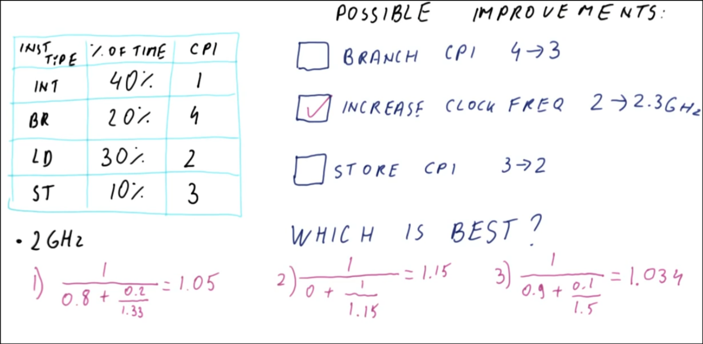

### Lhadma's Law

While trying to make the common case fast, do not make the uncommon case worse.

Even if improvement was infinite, speedup would only be 1.

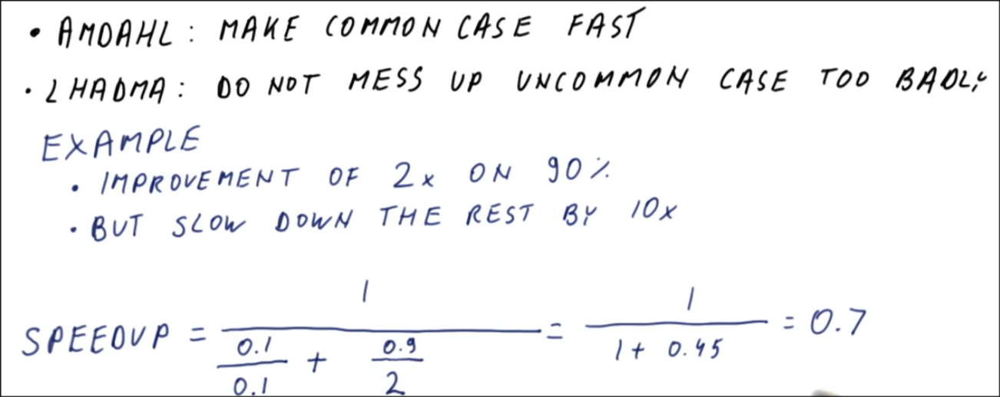

### Diminishing Returns

Once the easy changes for improvement have been made, further improvements will not yield great returns.
More and more work must be done to obtain small improvements and these improvements will result in small to nearly zero speedups.

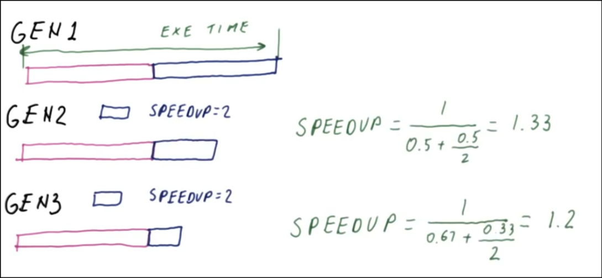