# Pipelining

Pipelining is crucial to improving performance in processors; it increases throughput and reduces cycle time. The downside of pipelines are the increase in hazards, both control and data.

## Pipelining in a Processor

1 instr/cycle:
1. PC fetches instr in IMEM
2. DECODE instr and read REGS
3. ALU to compute instr
4. access/write MEM

Five stages in a basic pipeline:

- Fetch
- Read/Decode
- ALU
- Memory Access
- Write the Registers

Pipelining the instructions takes the same amount of time, but throughput is improved.

Initial latency still the same (20ns), throughput 1 instr/4ns once filled

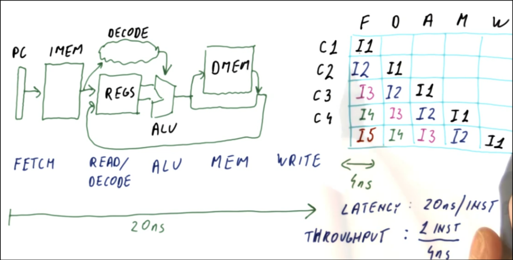

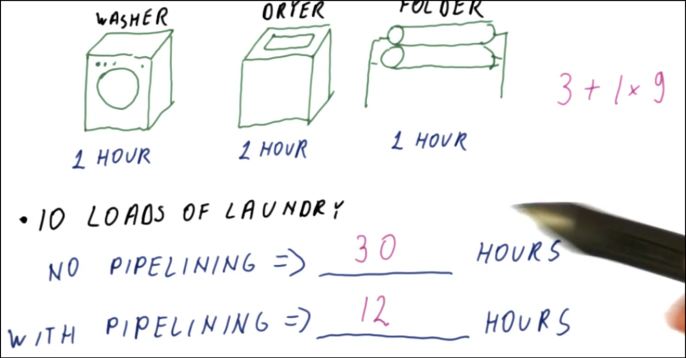

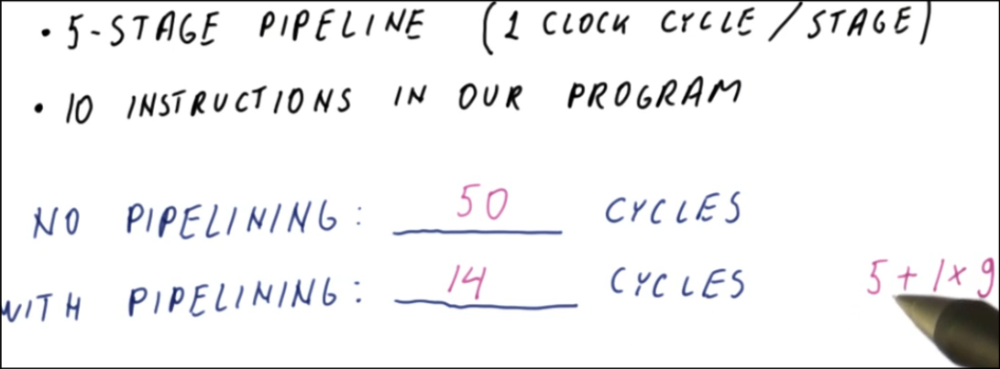

## Pipelining CPI

Pipeline CPI > 1?
- initial fill (cpi -> 1 when num of instr -> infinity)
- pipeline stalls

If there an instruction has to wait at a pipeline stage, all the instructions ahead of it proceed through the pipeline, all the instructions behind it are also stalled.
This is called a delay in the pipeline.
The pipeline ahead of the delay will not have instructions to execute as the pipeline empties and the instructions behind the delay will be stalled.

As the number of delays increase through the pipeline, the CPI will increase.

Pipeline needs 2 stalls for R1 to get loaded from MEM, and WR REG (assume write R1 and read R1 in same cycle). 5 cycles for 3 instr counting the stalls.

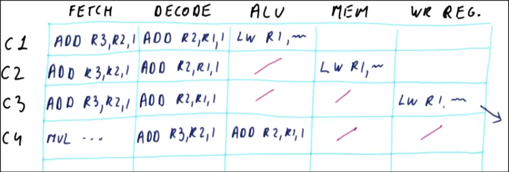

## Pipeline Stalls and Flushes

Pipeline Flush: Branches can cause bubbles when the incorrect branch is taken. When this happens all the incorrect instructions that were fetched must be flushed from the pipeline and replaced with NOPs. Then the correct instructions must be fetched.

Figure out jump at ALU, but sub and add instrs shouldn't have been fetched. Flush them, fetch correct instr after jump. 4 cycles for 2 instrs.

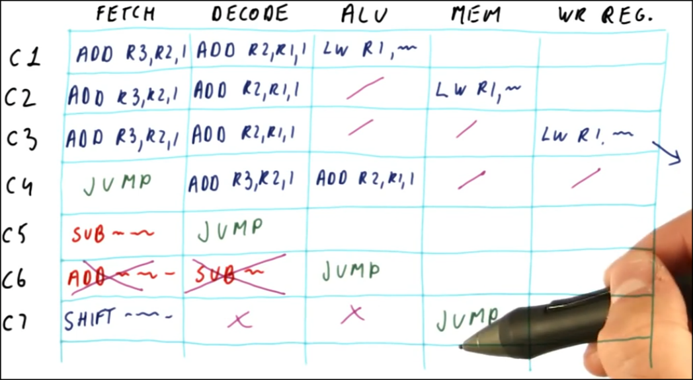

## Control Dependencies

Control dependencies: When an instruction is dependent on the outcome of a branch decision, these instructions are said to have a control dependence.

- 20% of instructions are branches and jumps
- 50% of branch and jump instructions are taken

    Overall CPI = CPI of program + % of instructions mispredicted * penalty for misprediction

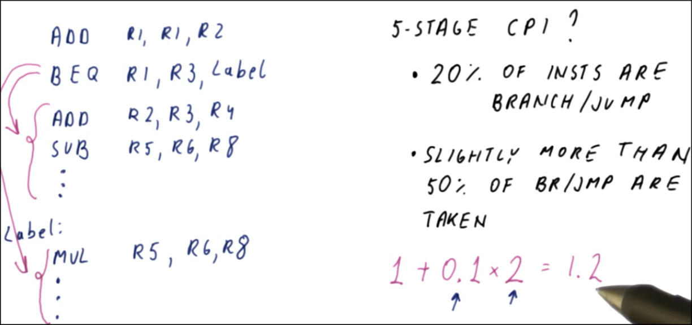

6th stage, so 5 cycles of instr from wrong place

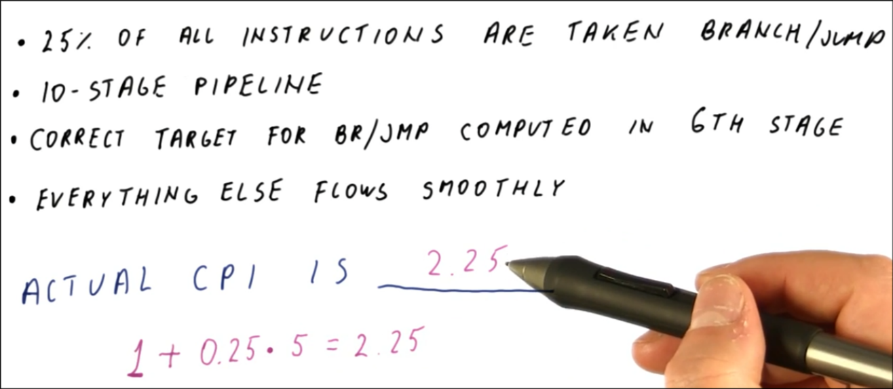

## Data Dependencies

Data dependence: When an instruction needs data from another instruction that is called a data dependence.

Type of data dependencies:

1. RAW - read after write. Also called Flow, True Dependence.

The following dependencies are False or Name dependencies.

2. WAW - write after write. Also called Output Dependence.
3. WAR - write after read. Also called Anti-Dependence

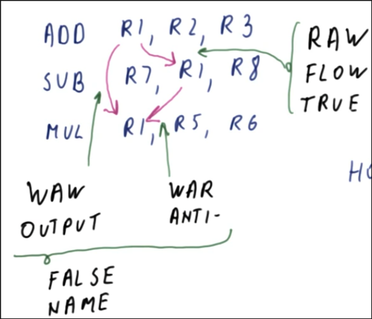

RAR - read after read is not a dependence.

- I1 -> I4, R1 of R4 is dependent on I3

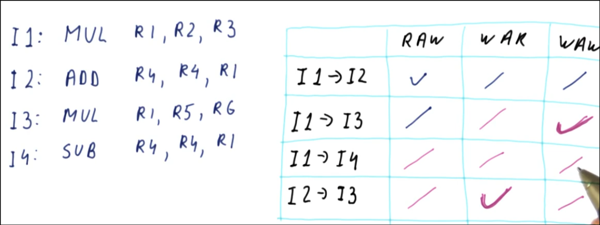

## Dependencies and Hazards

Dependencies are caused by the proerties of the program, not the pipeline.
- ADD -> MUL, WAW is okay bc it's sequentially written in pgrm order
   - Same as WAR for MUL -> SUB

Some dependences will not cause problems, but some, like RAW, can cause problems in pipelines.
- SUB -> DIV, RAW not okay bc DIV reading R4 in DECODE and computes in ALU before SUB written

Hazards are true dependencies that result in incorrect execution of the program, but not all true dependencies will result in a hazard.
- ADD -> XOR (R1) and MUL -> XOR (R7) RAW is okay
   - 3 or more instr between producing/consuming instr is ok

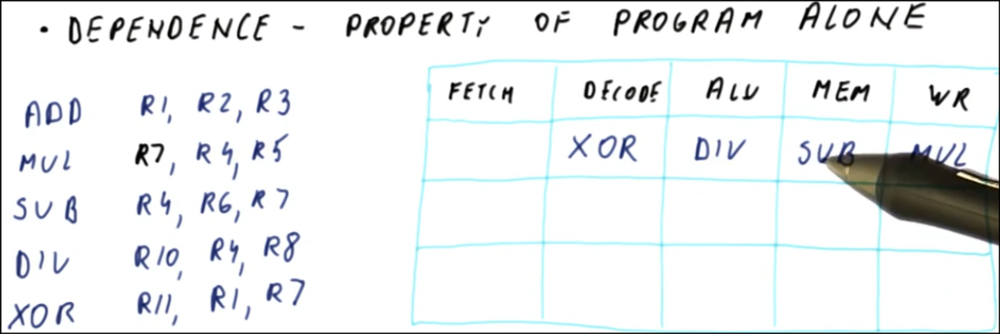

Hazards are caused by both the program and the pipeline.

- 3 stage pipeline

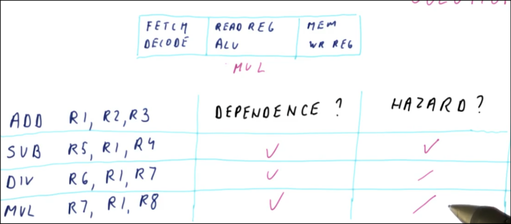

## Handling of Hazards

First step to handling hazards: Detect only those dependencies that will cause hazards.

Second Step to handling hazards: Remove the hazard.

Options for removing hazards are:

1. Flush dependent instructions out of the pipeline.
   - This method is used with control dependencies.
   - Since the wrong value is in the pipeline it needs to be flushed.
2. Stall dependent instructions in the pipeline.
   - This method is used for data dependencies.
   - This will give the data time to get written to registers before it is needed by a later instruction.
3. Fix the values read by dependent instructions.
   - This method is also used for data dependencies.
   - Instead of stalling the instruction until the correct values are in the registers, the pipeline can forward the required values.
      - The values from an ALU for example can be used as soon as they computed, rather than waiting.
      - This method does not always work, could be computed at later point.

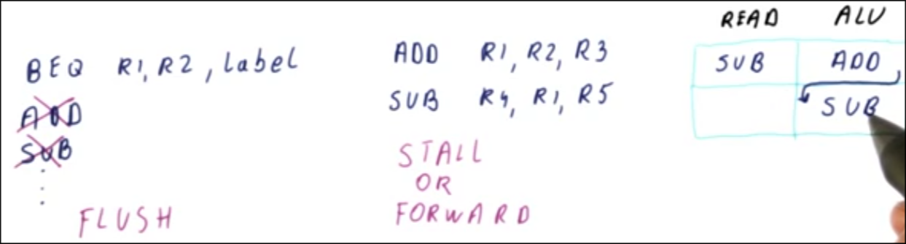

- LW -> ADD, R1 is only loaded once the MEM is done. Once MEM is done, also do a forward to prevent additional stall.

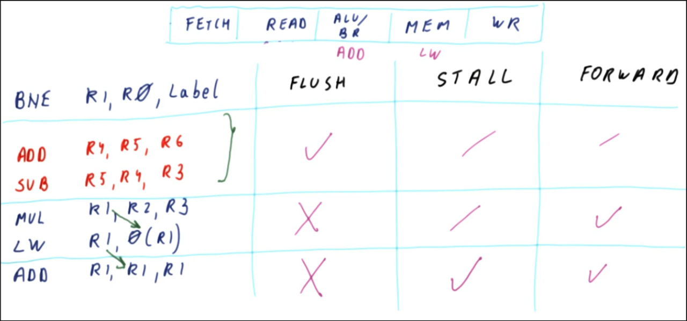

## How Many Stages

Every pipeline should be achieving the required CPI, it is different for every pipeline.

When more stages are added to a pipeline:

More CPI
1. There are more hazards introduced into the pipeline.
2. The penalty for hazards increases.
but cycle time can decrease...
3. There is less work for each stage, so the cycle time can be smaller.

The Iron Law of Performance says:

The number of stages must be balanced between the CPI and the cycle time.

If only performance is considered, 30 - 40 stages is ideal. But if power consumption (more pipeline latches for temp results) is also considered, the ideal pipeline is 10 - 15 stages.

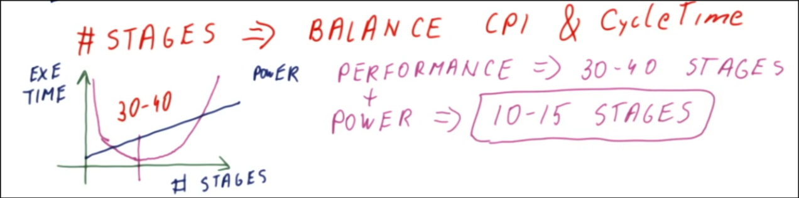