# Branches

Branches account for 20% of all instructions, so mispredicting then can have a major impact on processor performance. Understanding and improving branch prediction will greatly enhance performance.

## Branches in a Pipeline

- If a branch is not taken the PC just advances to the next instruction.
- If the branch is taken the immediate value is added to the PC to advance to the new destination.
- It is not known until the end of the ALU stage whether the branch is taken or not.
- It is better to make a prediction, then the processor is at least right some of the time.
  - If mispredicted, the branch cost is 3 cycles (1 BEQ, +2)
  - Only have BEQ info from fetch (the instr), not known until DECODE

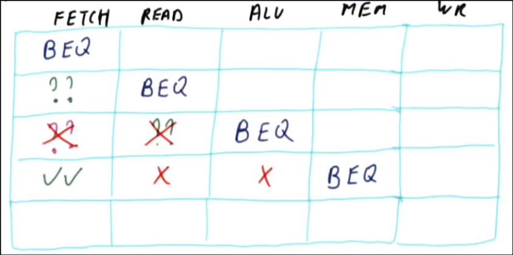

## Branch Prediction Requirements

Branch prediction must be based on the available information, which is the PC of the instr.
- Need to guess PC of next instr to fetch

Using only the PC, the processor must try and correctly guess if the instruction is a taken branch and if so, what is the new PC.
- Is this a (taken) branch?
- If taken what is the target PC?

## Branch Prediction Accuracy

    CPI = 1 + (Mispredictions / Instruc) * (Penalty / Misprediction)

- Mispredictions/Instruction is dependent on the predictor accuracy
- Penalty/Misprediction is dependent on the size of the pipeline

The deeper the pipeline the more important it is to have an accurate branch predictor; more speedup for accurate predictor.

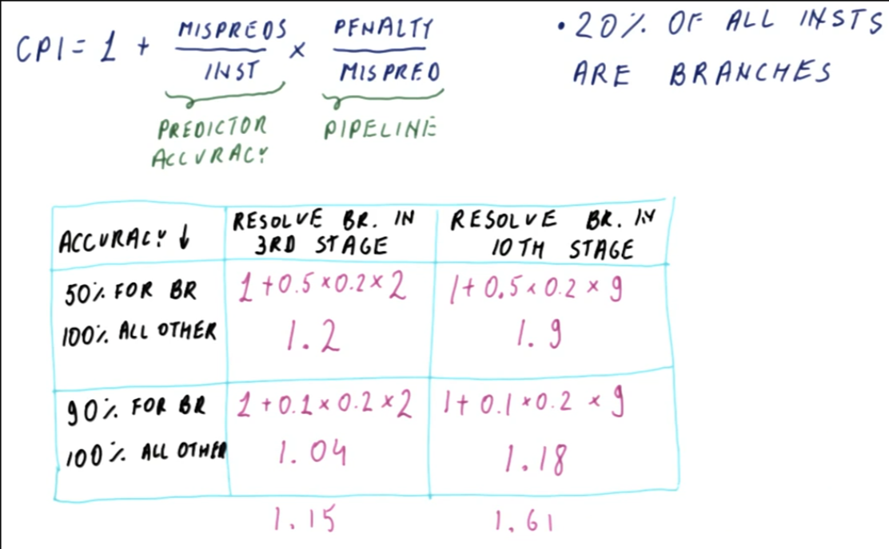

- When ADDI in FETCH, not sure if it's a branch until DECODE (2 cycles = 1 FETCH, 1 bubble until DECODE).
  - Same for ADD.
- Not sure if BNE taken until ALU, 2 bubbles so 3 cycles.

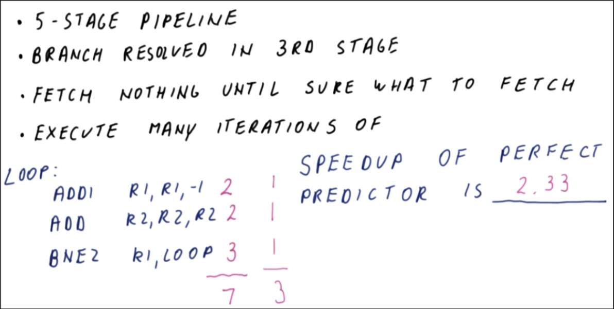

## Performance with Not-Taken Prediction

- Refuse-to-predict waits to determine if the instruction is a branch
  - Every branch costs 3 cycles
  - Non-branches cost 2 cycles
- A not-taken prediction just fetches the next instruction.
  - Every branch costs 1 or 3 cycles (1 the branch is not taken, 3 if it is taken)
  - Non-branches cost 1 cycle

Every processor will perform some type of prediction, even if it's just incrementing PC and fetching next instr.

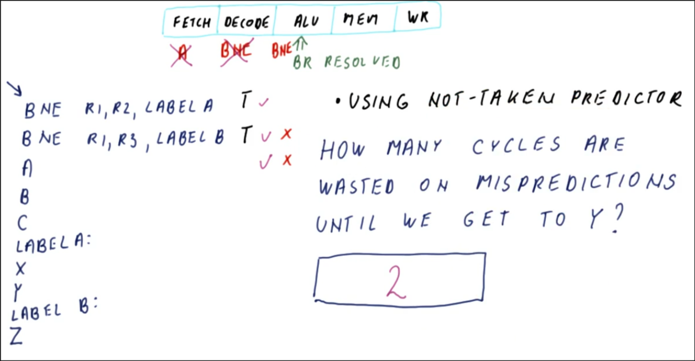

## Predict Not Taken

The Not-taken predictor is the simplest predictor, just increment the PC.

- 20% of all instructions are branches, 60% of branches are taken.
- So Predict Not-Taken is correct 88% (80 + 8 from 40% not taken) of the time and incorrect 12% (60% of 20) of the time.

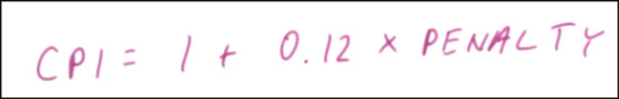

## Why Do We Need Better Branch Prediction?

The larger the pipeline, the greater the penalty, especially when the branches are detected later in the pipeline and there are multiple instructions per cycle.

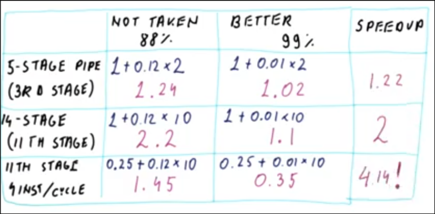

31 stages until branch resolved.

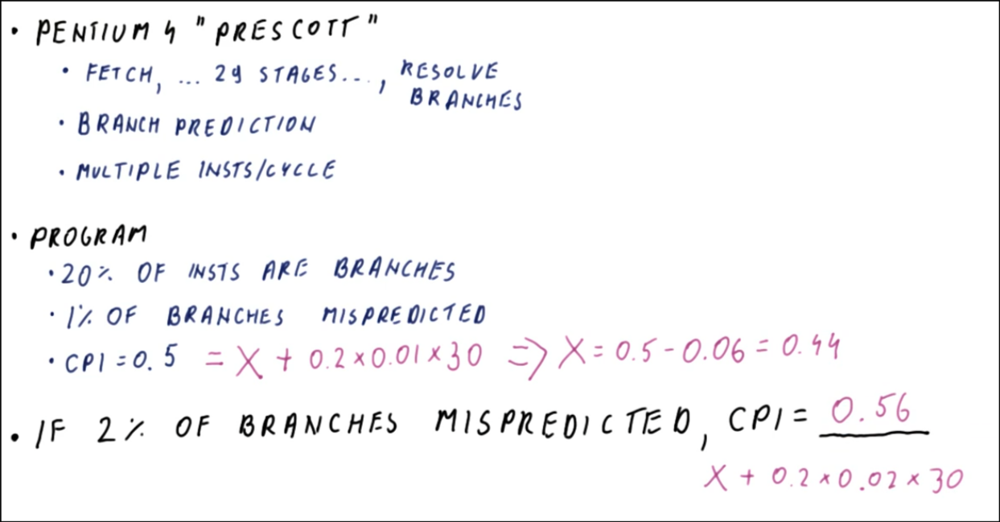

There is a lot of waste from a misprediction, especially if it is a deep and/or wide pipeline.

- instr lost from misprediction

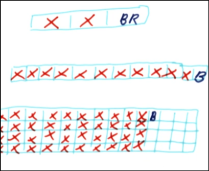

## Better Prediction - How?

All that is known about the instruction is the PC.
A better prediction would require more knowledge about the instruction. 
Since this is not possible another method of improving prediction is needed.

Branch prediction can come from using the history of the instruction to make a better prediction.

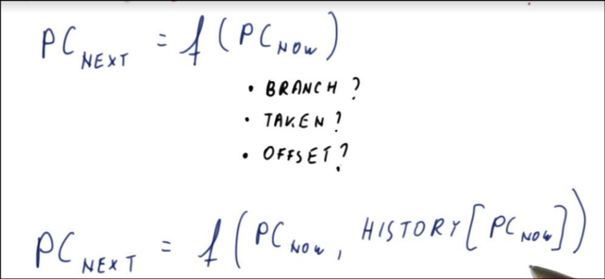

## Branch Target Buffer (BTB)

The Branch target buffer holds the target PC, it is indexed by PC number.

### BTB Steps

1. At Fetch the processor has the PC of an instruction
2. Looks in the BTB for this PC number
3. The processor reads out the prediction for the next PC.
4. This predicted PC is then compared with the actual PC that is generated later in the pipeline.
5. If the BTB prediction and the actual PC are the same - this is a correct prediction. If the two are not the same - this is a misprediction, and the correct PC is stored in the BTB.

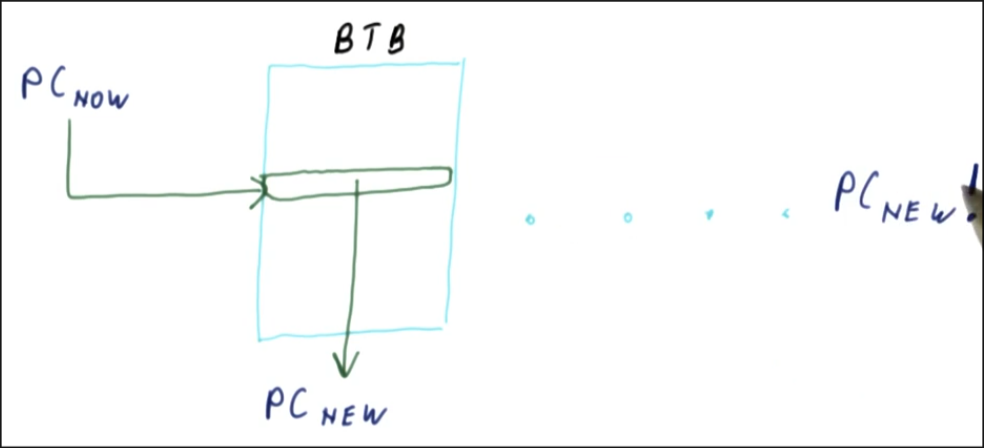

### Realistic BTB

- The BTB needs to have a 1 cycle latency, so it needs to be small.

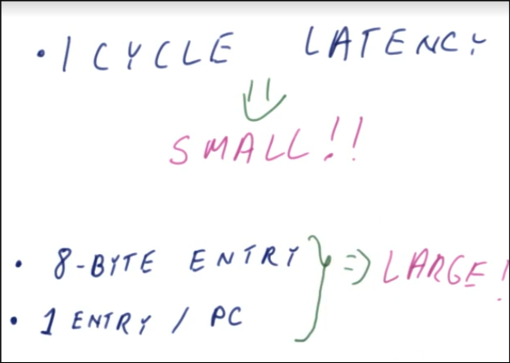

- The BTB needs to hold only the instructions that are likely to be executed soon (i.e. entries for all instr in a loop)

- Use the LSB for indexing to the BTB.
  - Need 10 bits to index into BTB, take least significant 10 bits as index (1024 entries)
  - Want each instr to have diff entry from nearby instr (loops, funcs...), MSB could be the same

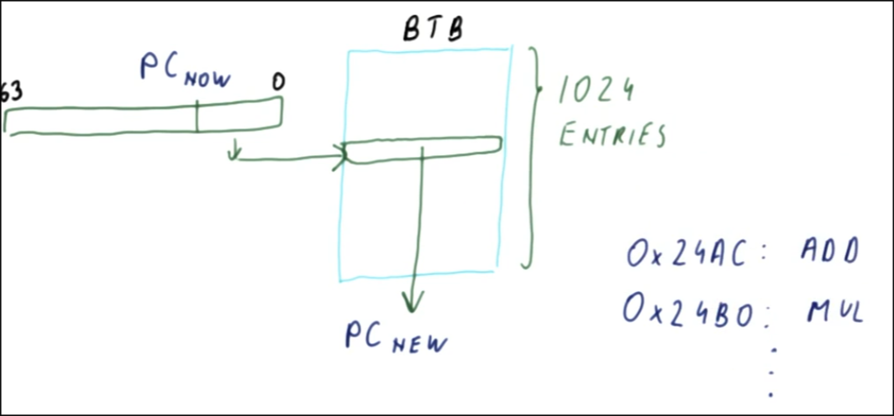

- need to be word aligned, so take the next 10 LSB that are diff
- `0x2C3`

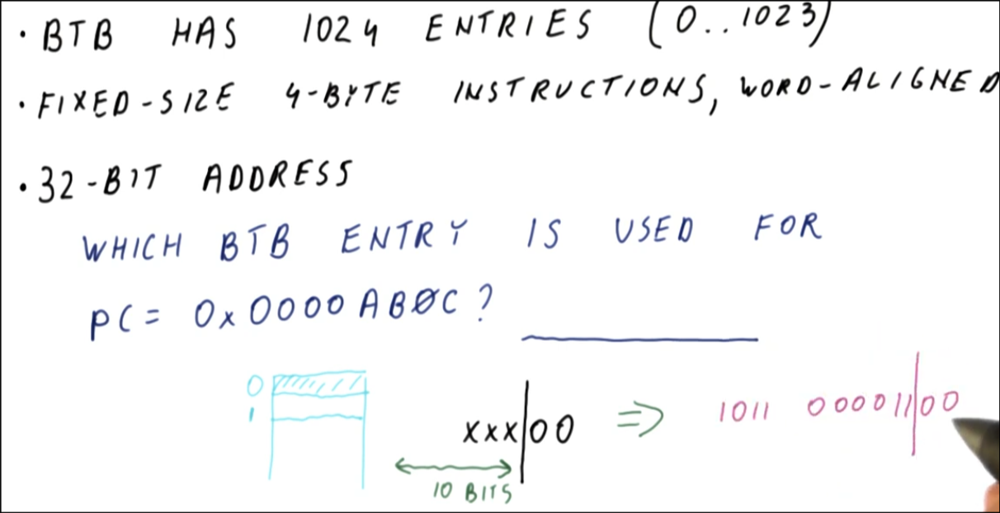

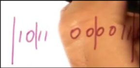

## Direction Prediction

Use a Branch History Table (BHT) to first determine if the branch is taken (1, write dest addr to BTB) or not taken (0, increment PC).

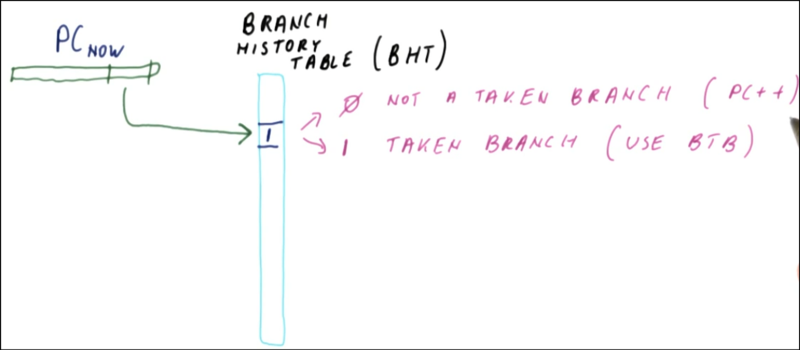

### Steps for BHT

1. Use the LSB of the PC to index the BHT.
2. The simplest BHT will have 1 bit.
   - 0 = branch not-taken.
   - 1 = branch taken.
3. If BHT = 0, just increment the PC. If BHT = 1, look up the new PC in the BTB

Since the BHT stores just 1 bit, it can store the history of a lot of instructions.

The BTB is only accessed when the BHT says the instruction is a taken branch, reserve BTB only for branches in the code.

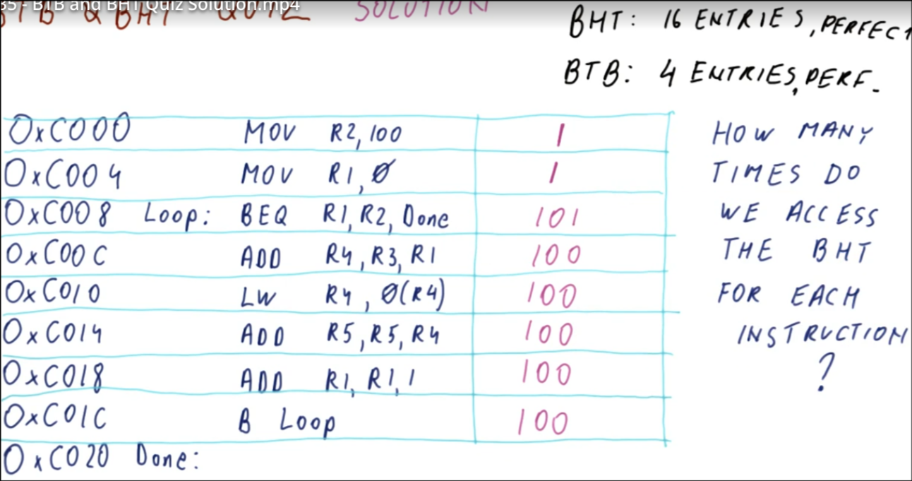

Use LSB that are not the same for the entries. Every instr incrementing by 4, lowest 2 bits not changing. 16 BHT entries = 4 bits.

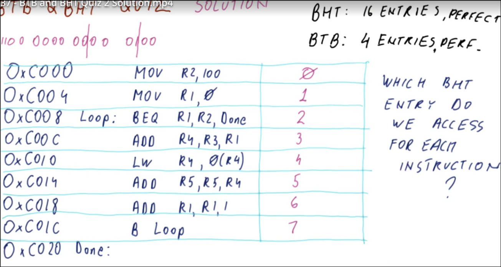

BTB only accessed if BHT says this instr is taken branch, otherwise just increment the PC.

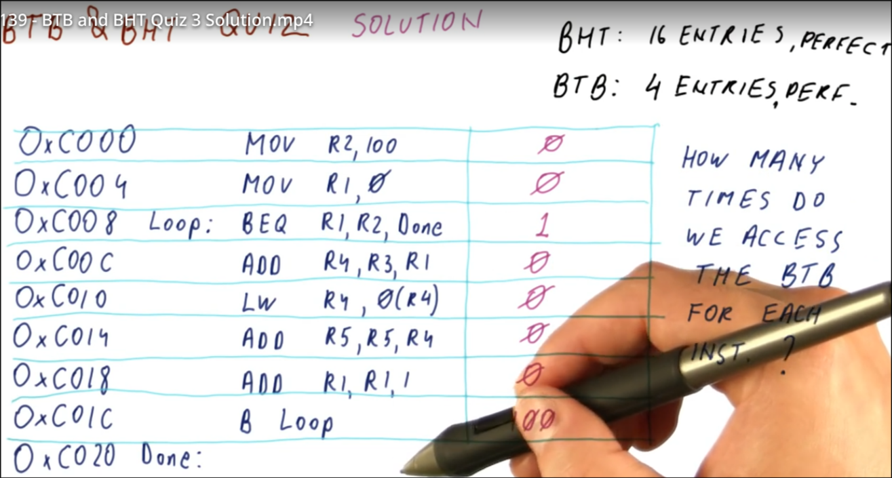

BTB 4 entries = 2 bits, but not the ones that are always the same.

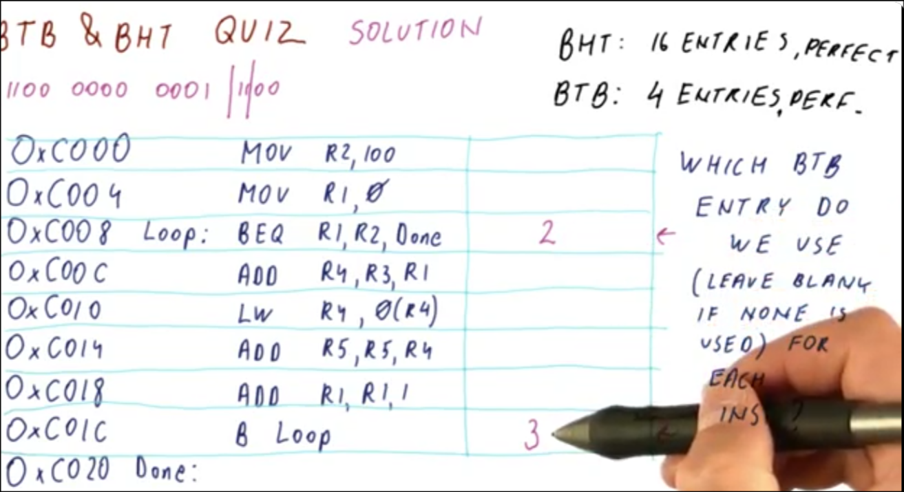

BEQ no misprediction the first time since we don't take. B Loop is taken, so misprediction the first time, then the BHT entry is updated.
The last time BEQ is taken, so misprediction there.

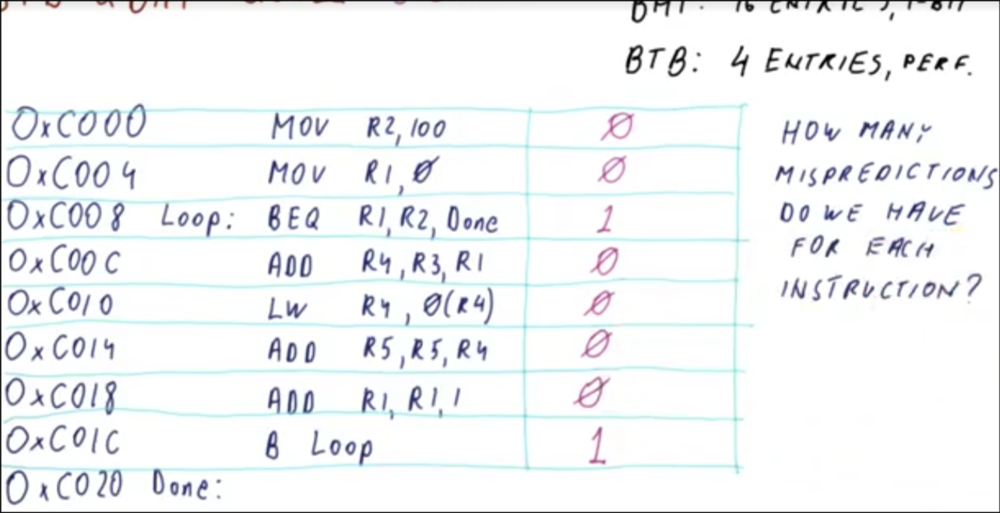

## Problems with 1 bit Predictors

The 1 bit predictor is very accurate, it works well for large loops with many iterations.
This is because these branches tend to be always (or almost always) taken or not-taken.

1-bit predictors do not do well when the branch is not so predictable.

Each anomalous behavior with result in two mispredictions, so if the behavior changes a lot there will be many mispredictions.

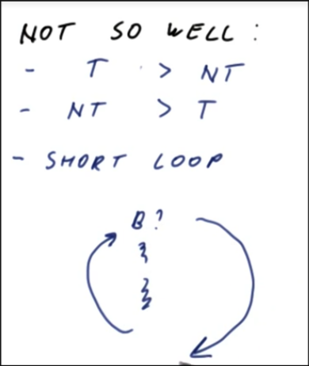

Short loop: mispredictions at beginning and end of thet loop.

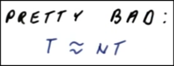

## 2-Bit Predictors (2BP or 2BC)

A 2-bit predictor can reduce the number of mispredictions when there is a change in the branch prediction.

The two bits in the 2BP play the following roles:

- MSB - the prediction, taken or not-taken
- LSB - the conviction bit, sure, or not sure

- 00 - not-taken, strong
- 01 - not-taken, weak
- 10 - taken, weak
- 11 - taken, strong

A single anomaly will cost 1 misprediction, a change in behavior will cost 2 mispredictions.

### Predictor State Transition Table

| Present State | Actual Branch Event | Predictor Next State |
|---|---|---|
| 00 | not taken | 00 |
| 00 | taken | 01 |
| 01 | not taken | 00 |
| 01 | taken | 10 |
| 10 | not taken | 01 |
| 10 | taken | 11 |
| 11 | not taken | 10 |
| 11 | taken | 11 |

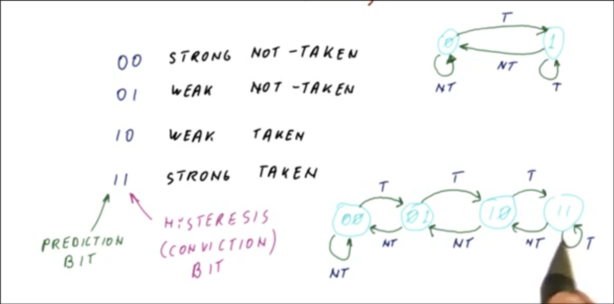

### 2-Bit Predictor Initialization

- If the 2BP starts in a weak state (01 or 10), this will lead to zero mispredictions if correct and only one misprediction if wrong.
- If the branch is alternating between taken, not-taken, starting in a weak state will lead to more mispredictions, worst case. This condition is slightly less likely to happen.
- Most predictors just start in the 00 state because it is the easiest to initialize.

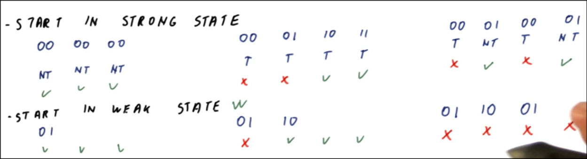

- Every predictor has a sequence that will result in every prediction being wrong, just a matter of how likely.

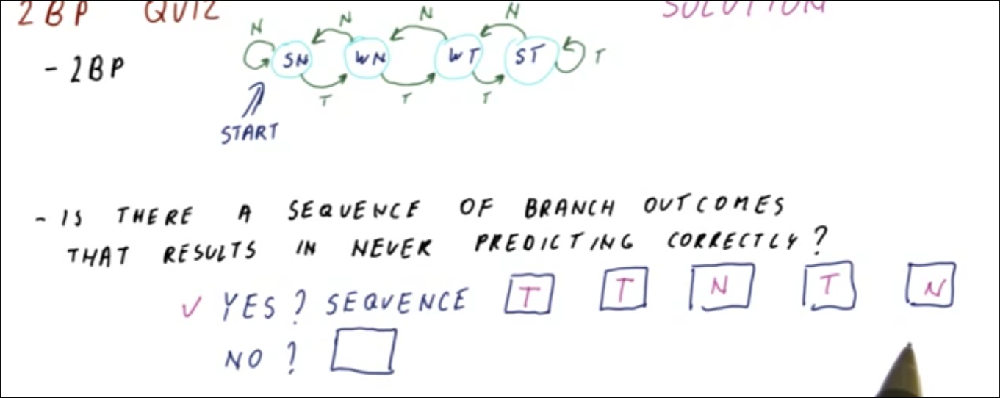

### 1BP → 2BP

More bits in a predictor leads to more cost, without greatly improving the predictor accuracy. Good when anomalous outcomes come in streaks, but how often does this happen?

## History Based Predictors

Using history of the branch, the alternating patterns predictions can be learned.

100% predictable, but not with simple N-bit counters.

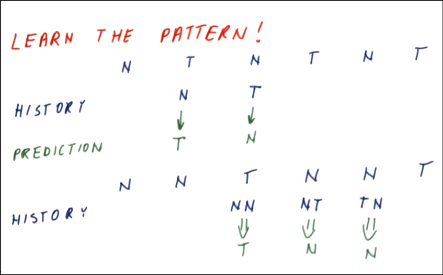

### 1-Bit History with 2-Bit Counters

Steps for BHT with history:

1. Look up the BHT index with the PC
2. The BHT's entries will have a 1-bit history, a 2-bit counter for history = 0, and a 2-bit counter for when the history = 1.
3. Look at the history bit. If the history bit = 0, use the first counter, if history bit = 1 use the second counter
  - 1 bit for taken (1)/not taken (0) for outcome

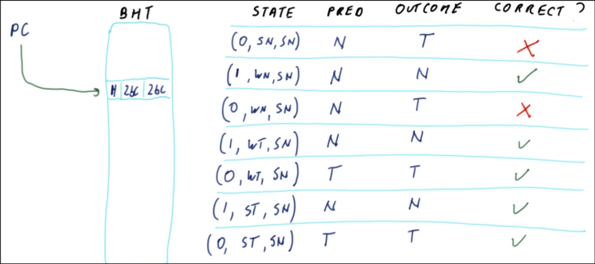

1 bit history predictor not great for NNT

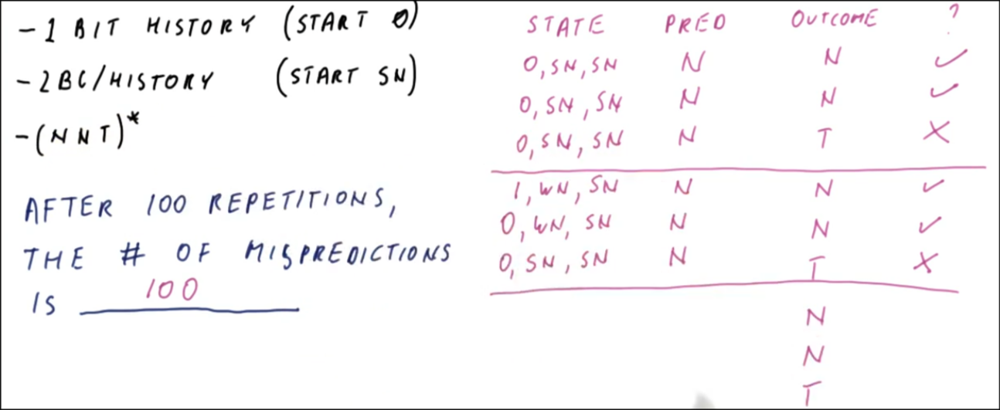

### 2-Bit History Predictor

The pattern NNT mispredicts 1/3 of the time when a 1-bit history predictor is used.

Using a 2-bit predictor will solve this problem.

If a 2-bit history predictor is used the BHT now has 2 bits for history, and four 2-bit counters.

10 bits for a branch entry.
- CNT0 ST
- CNT1 SN
- CNT2 SN
- CNT3 not possible, would need TT

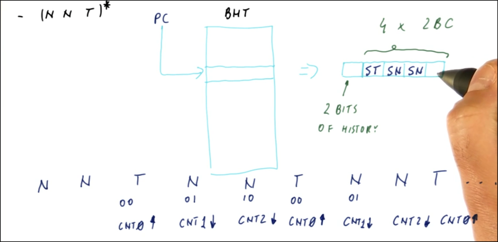

- Wasting 1 2 BC.

For NT, CNT1 SN CNT2 ST, only using 2 entries.

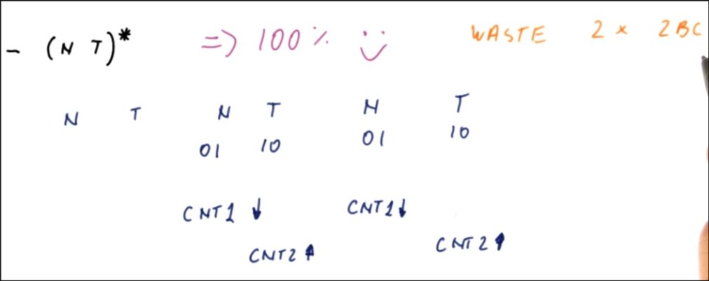

## History Based Predictors with Shared Counters

The cost of adding counters to each entry in the BHT can become prohibitive. Sharing counters between entries is a good alternative since most of the counters are not used.

- An N-bit History Predictor will predict all patterns/histories of length <= N+1
- An N-bit History Predictor will cost N + 2*2^N per entry, with most of the counters wasted.
- 2^N counters per entry, only about N counters used

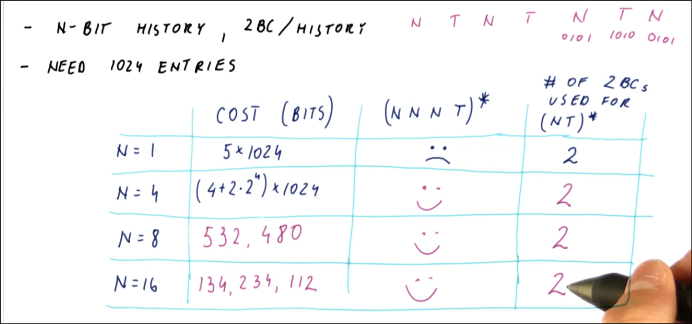

Need at least 1 entry per branch. 8 times in the loop, 9th time jumps out = length 9 pattern. 2^(num of bit history) is the num of counters.

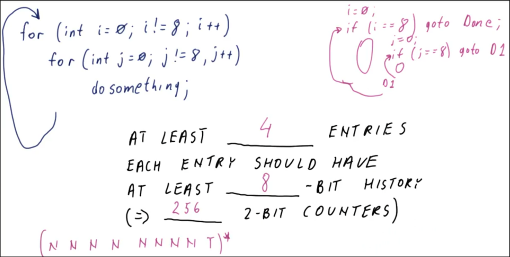

Idea: share 2 BCs between entries.

Use a Pattern History Table (PST) to reduce the cost of the predictor.
- A pattern of 2 uses two counters, which means two entries in the BHT.
- A pattern of 16 uses 16 counters (16 entries in the BHT).

Index PC, keep history bits as entries in PHT, combine history bits (xor) with PC, index into BHT whose entries just single 2 BC (T or N)
- 11 bits of PC, index into PHT, ex: 11 bits of history. 2 bits for counters.

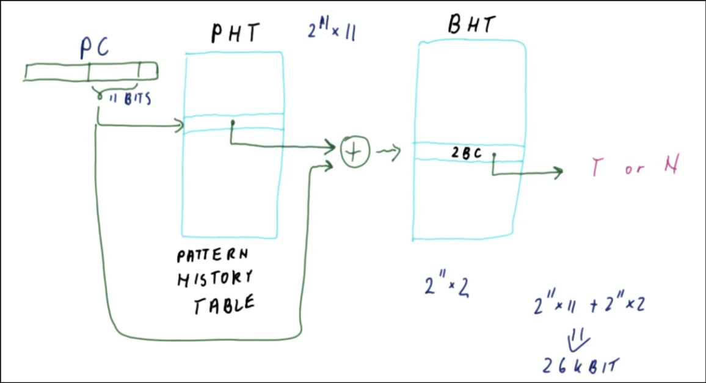

TTTT/NNNN always taken, uses only 1 counter (11 bit history + 2 bit counter).
- Some branches might overlap with which counter to use, branches that need more counters get them

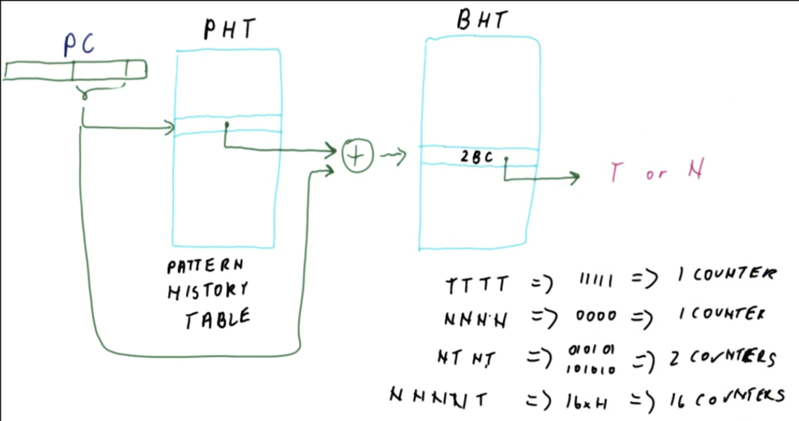

## PShare

- PShare = Private history, shared counters - good for small loops and predictable short patterns (TN).
- GShare = Global history and shared counters - good for correlated branches (branches whose decisions related to other branches in pgrm).

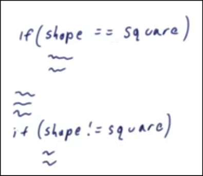

- BEQ R1 single misprediction on exit.
- BEQ R2
  - NT, T, T, N, N, T
  - Need history for even/odd
- B Loop any history works.

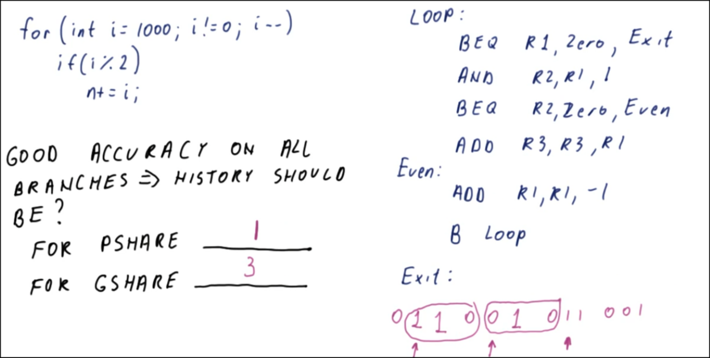

### GShare or PShare

Use both in a processor. GShare for correlated branches, PShare better for shorter self similar branches.

## Tournament Predictors

Using two different predictors requires choosing one, but which one?
- One better for branches XYZ, other better for ABC

A tournament predictor can predict which predictor has the better prediction.

Use PC to index into both GSHARE/PSHARE, and META-PREDICTOR (2BC) telling which of the two is more accurate for the branch.
- META-PREDICTOR trained on how well the two predictors are doing (counting up/down to choose which predictor to use)

| GShare | PShare | MetaPredictor |
|---|---|---|
| Correct | Correct | no change |
| Correct | Incorrect | count down |
| Incorrect | Correct | count up |
| Incorrect | Incorrect | no change |

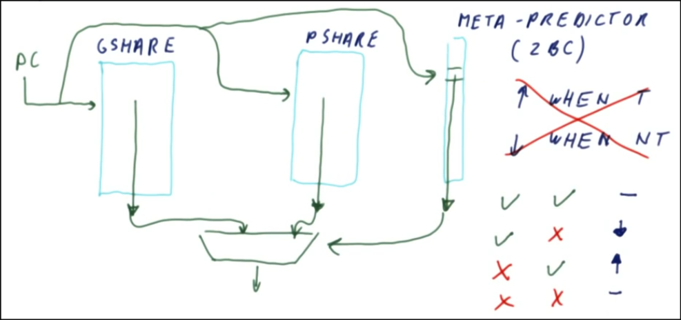

## Hierarchical Predictors

While a tournament predictor combines 2 good predictors, a hierarchical predictor combines 1 good and one okay predictor.
- Good predictors cost a lot for each entry
- Don't need good predictors for easily predictable branches

In a tournament predictor both predictors are updated with every prediction.
With a hierarchical predictor the good predictor is only updated when the okay predictor is incorrect, okay predictor updated on each decision.

Local/Global has the history array + 2 BC. Global has a tag array that says if branch was predicted there, if not, use the Local tag array that says if predictor should be predicted there, otherwise result of 2BC.
- Tag array is some bits of the PC/branch addr to index, some bits indexed in Local/Global to find history

If 2BC mispredicted, insert into Local, if Local mispredicted insert into Global.
Most simple cases in 2BC, saves space in Local/Global for complex cases.

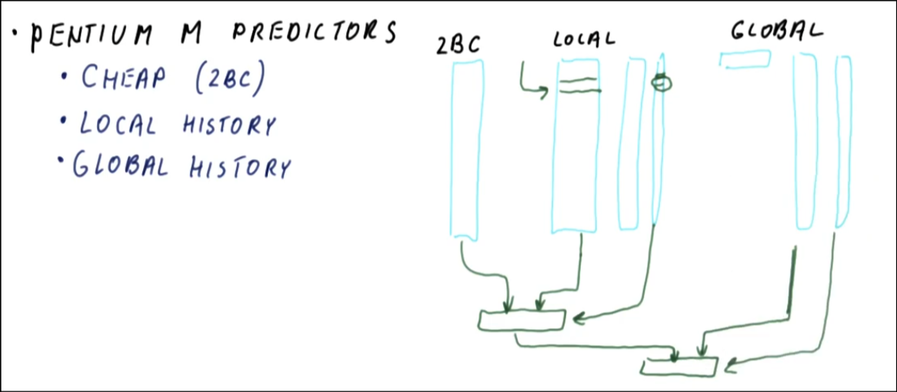

P/GSHARE have diff strengths, don't combine using hierarchal but tournament.

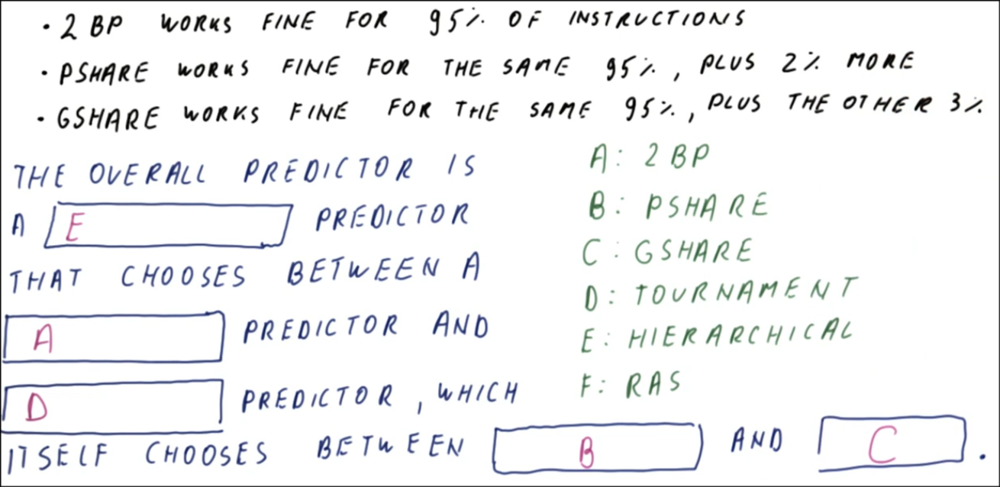

## Return Address Stack Predictor

BNE
- Direction (predictors work reasonably well for example)
- BTB fine, always same target

JUMP, CALL.
- Direction (always taken, even simplest predictor works)
- BTB fine, either jump to label or target

If a branch is taken, the return address must be predicted. There are different types of branches:

- Conditional branches: the BTB will work for predicting RAS
- Unconditional branches: the BTB will work for predicting RAS
- Function Returns: use a RAS predictor
  - Function called from diff places, not just from the same place typically (RET instr jumps to place it was called from); use RAS

RAS - a small hardware stack that is dedicated to storing the return addresses for functions.
- Func call, push RET addr to RAS and move ptr
- RET, pop RAS and get correct target addr (don't have to delete entry, ptr being there means it's free)

Need to make prediction quickly, limited number of entries.

When the RAS is full, use the wrap around the approach for replacement.
- Can either not push or wrap around

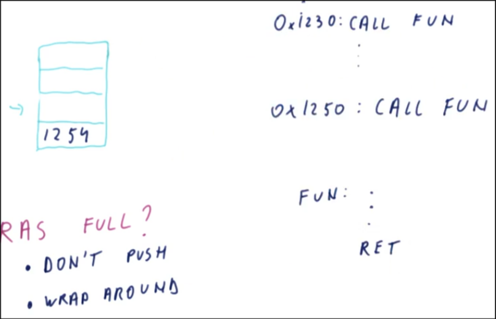

Wrap around is better. 
Don't push spending entries just for long term things, just so it can use when RET from large func.
Wrap around would correctly predict many small funcs, in return for incorrectly predicting the RET for the large func. Choose which one gives more correct predictions.

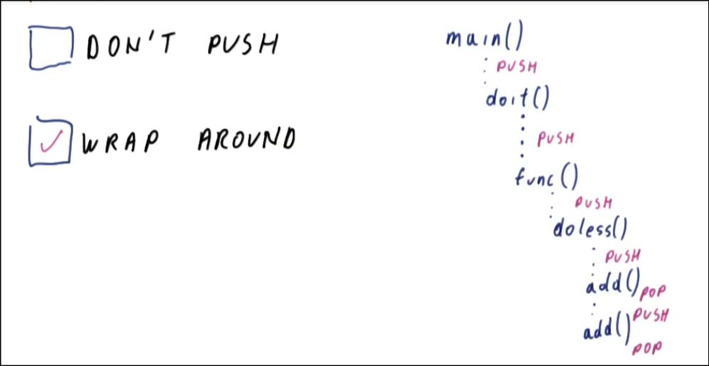

The return instruction needs to be identified before decoding. There are two ways to do this, using a predictor or using predecoding from the prefetch.

### How do we know its a RET

Use a predictor or predecoding to determine when an instruction is a RET.

Using RET while FETCH, not decoded yet.

Using predictor to check if instr is RET or not
  - Accurate

Predecoding
  - Annotate instr in cache (enough to know if it's RET or not)
    - 32 bit of instr + 1 bit to know if RET or not

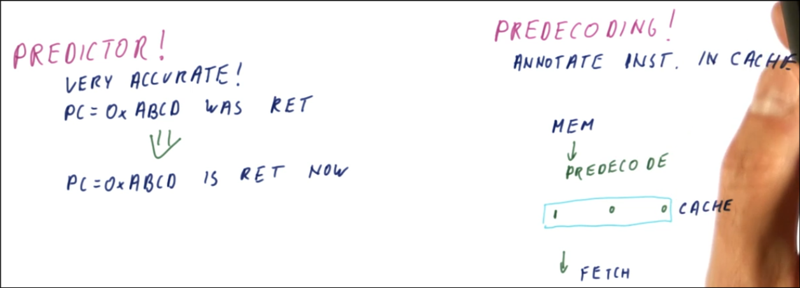