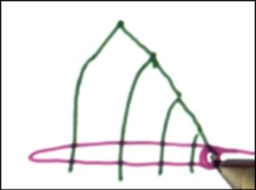
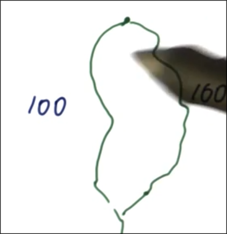
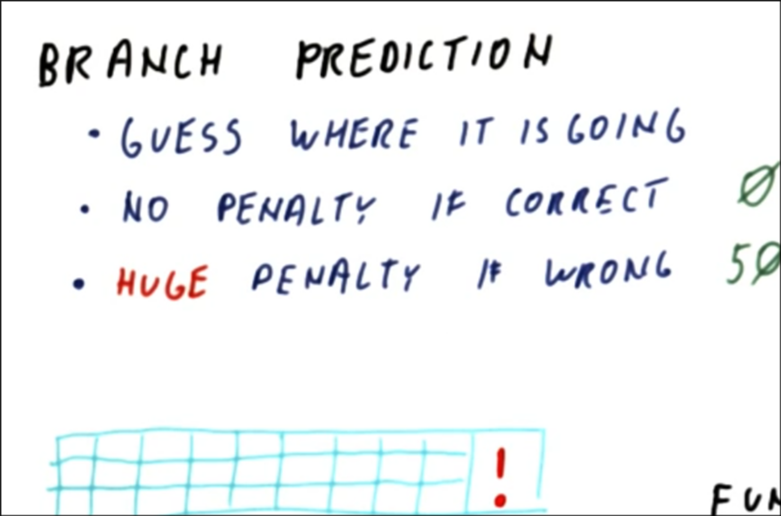
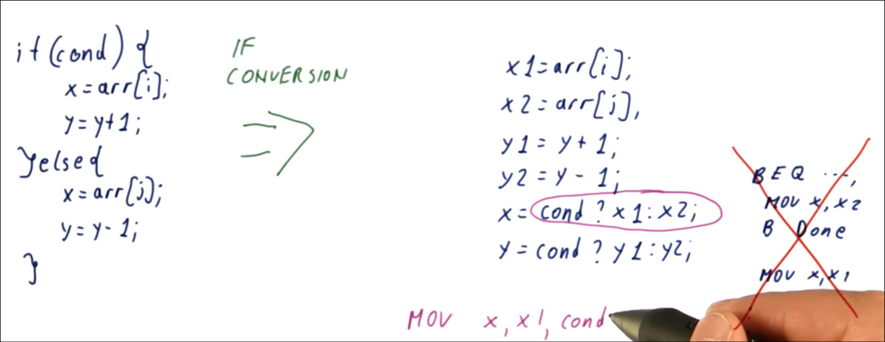
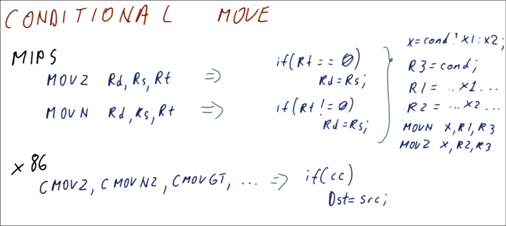
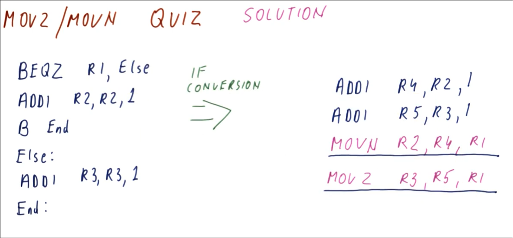
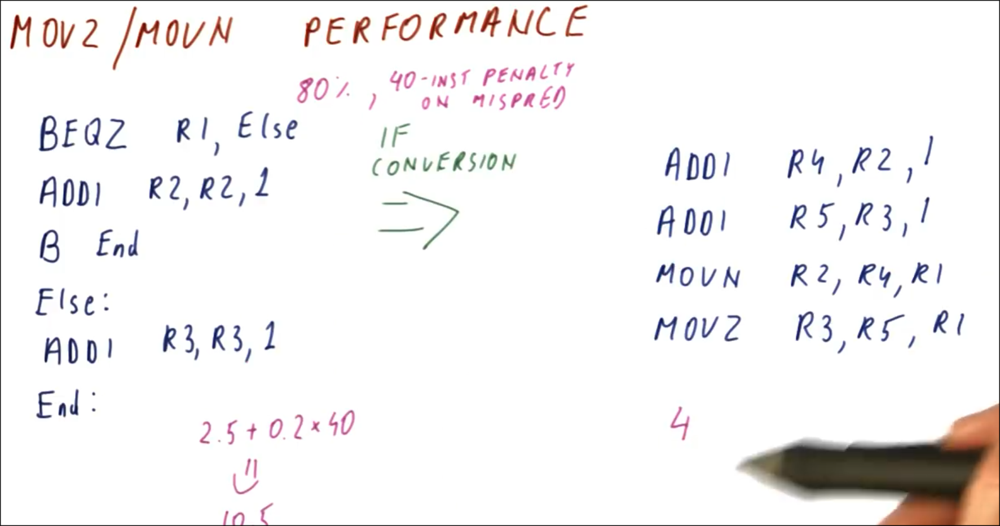
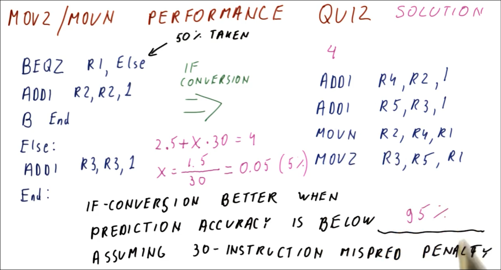
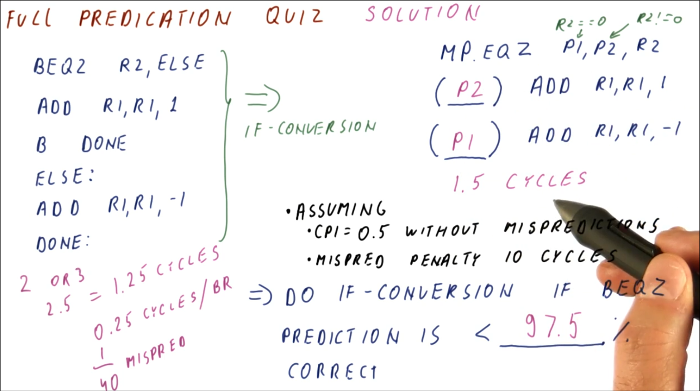

# Predication

Some branches are hard to predict, such as small if-then-else statements. For these instances predication should be used.

Branch prediction
- guess where it's going
- no penalty if correct
- huge penalty if wrong (pipelining with high IPC)

Predication is doing the work of both directions and the choosing the correct one and throwing away the incorrect path work.
- waste up to 50%

- Loops - prediction is better than predication
    - more iterations = more predictable
    - more work towards exiting the loop than staying in over time

- Function Calls and Returns - prediction is better than predication
    - direction is always taken
- Large If-then-Else - prediction is better than predication
    - penalty for predicting wrong less than the predication throwaway

- Small If-then-Else - predication is better than prediction, unless the predictor is very accurate
    - predication waste 5 either way (1.00 * 5 = 5)
    - if prediction accuracy 90% or better here, better off predicting here (0.10 mispredicting * 50 = 5)
    - if the if else is smaller, favors predicating

To convert if-then-else statements use Conditional Instructions. Conditional instructions are instructions that do two functions atomically, such as MOVC.

## IF-CONVERSION
- need some way to move x1 into x if a flag is true
- would've converted one branch into another branch, unless there's another predictor could have two mispredictions instead of one

## CONDITIONAL MOVE
- if condition, dst gets src otherwise nothing

- If R1 0, branch to else (taken, R5)
- Otherwise increment R2 and go to end (not taken, R4)
- If R1 not 0, move R4 into R2
- If R1 is 0, move R5 into R3
- 4 instr, but no branches (original has 3 + 2 inst + branch to predict)

## MOVZ/MOVN Performance
- Suppose B End perfectly predicted, 80% accurate for the BEQZ + 40 instr penalty on mispred
    - 3 or 2 instr on either path
    - Say 2.5 instr on avg + 0.2 * 40 = 10.5 instr vs 4 on avg

- 50% taken means on avg, execute half of the time 3 and 2 instr
    - perfect prediction = 2.5 instr on avg per execution
    - 2.5 + x * 30 = 4, where x is misprediction rate

## MOVC

1. compiler support is required to convert if-then-else.
2. will remove hard-to-predict branches
3. more registers are needed
    - results from both paths (?)
4. more instructions are executed
    - both paths
    - movc to select actual results (?)
- ?: get rid by changing ISA to make every instr conditional = full prediction

(#3 and #4 require extensive hardware support to achieve full predication)

## Full Predication HW Support

Predication bits need to be added to every instruction. These bits tell the processor where the qualifying predicate can be found
- qualifying predicate: where the condition for doing the write to the r1 reg will be found in
    - least significant 6 bits

- MP.EQZ P1, P2, R1
    - P1/P2 predicates always opposite (R1 = 0, P1 T, R2 != 0 P2 T)
- (p2)
    - predicate with p2, only done if R1 != 0
- (p1)
    - predicate with p1, only done if R1 == 0
- can use same regs, no additional work to move into dest regs
- condition set followed by code from both paths, only overhead is doing work from both paths

- cpi 0.5
- if conversion 3 instr: 3 * 0.5 = 1.5 cycles
- prediction 3 or 2 instr, say 2.5 instr on avg: 2.5 * 0.5 = 1.25 cycles (without misprediction)
- if/prediction performs equally if the misprediction cost is 1.5 - 1.25 = 0.25 cycles/branch; if incurs 0.25 more cycles if perfect prediction
- find misprediction rate where the 10 cycle penalty balances out to 0.25 cycles/branch
    - 10 cycles/misprediction * x = 0.25 cycles/branch = 1/40 or 0.025 mispredictions per branches

