# ILP

Branch predication and if-conversion help pipelining issues from control hazards. ILP helps with data dependency issues preventing us from getting 1 instr per cycle.

- 5 cycles for infinite num of instr, almost 0 cycles per instr very good
  - first instr executes correctly, second one not reading the updated R1
  - figure out which instr can/cannot be executed in the same cycle

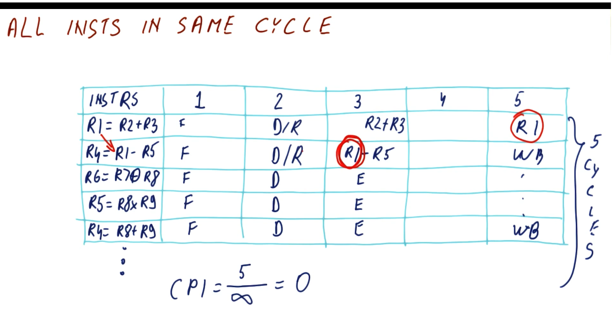

- dependence between I1 and I2
  - with forwarding, I2 needs to stall an additional cycle for I1 to complete; others can continue
  - 2 cycles to complete: 2/5 = 0.4 increasing from 1/5 = 0.2 for CPI

Performance improvement can be found by increasing the instruction level parallelism (ILP). To increase ILP false dependencies must be removed. Register renaming is one method of removing false dependencies.

The Execute Stage forwarding can supply the data in the NEXT cycle, not in the same cycle. So for a RAW dependency, the read instruction must be delayed to allow time for the write.

## RAW Dependencies and WAW Dependencies

The CPI is dependent upon RAW dependencies.
- ps'ers still has to wait for instr to be produced before using it for other instr
  - First cycle I1 and I3 runs, second I2 and I4, last is I5 (3 cycles, 5 instr = 0.6 CPI)
    - If raw dep between I1 and I2, CPI is 1 (ps'er can fetch/decode any num of instr but can't provide time travel, for example)

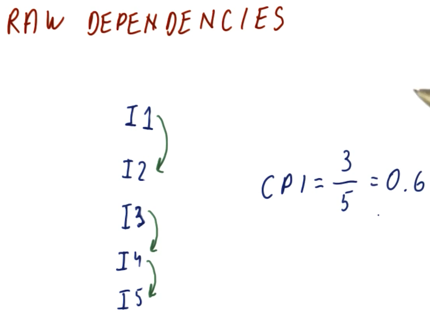

WAW dependencies can cause out-of-order instructions.
- RAW between 1st and 2nd instr, in cycle 5 R1 executes and R4 cannot has to wait until 6
- R4 will be whoever wrote to it last
  - 2nd instr got delayed, wrote in 8th cycle vs the 5th instr wrote in 7th cycle
  - could stall 5th instr 2 cycles, write in 9th cycle

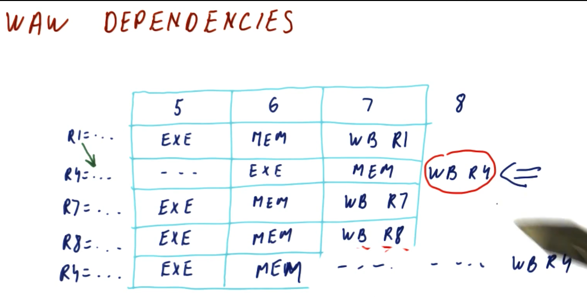

- ALU forwarding: instr 1 in MEM, instr 2 in EXE reads the computed result from instr 1's completed EXE (via EX/MEM).
- Load-use forwarding: instr 1 in WB, instr 2 in EXE reads the memory data from instr 1's completed MEM (via MEM/WB, after a 1-cycle stall).
- ALU-to-Store data forwarding: instr 1 in WB, instr 2 in MEM reads the data-to-store from instr 1's completed EXE (via MEM/WB, zero stalls).
- Load-to-Store data forwarding: instr 1 in WB, instr 2 in MEM reads the loaded value from instr 1's completed MEM (via MEM/WB, zero stalls).

- cycle 0 is fetch, read cycle 1...
- make sure the writes don't go out of order, put cycle nums down

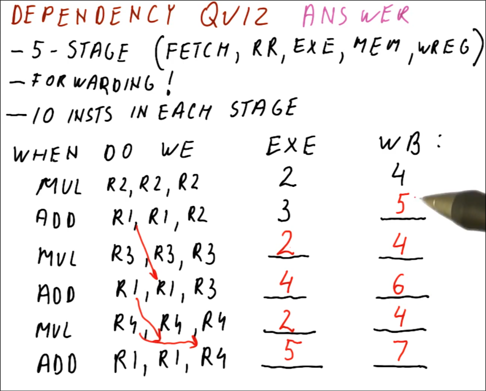

## Removing False Dependencies

RAW dependencies are true dependencies because the program requires a specific order of the instructions (have to obey).

WAR and WAW are false dependencies because the dependency is caused when the same register is used to hold results (can execute instr earlier if you can take care of multiple values for the same register).

## Duplicating Register Values

- supply R1, R4 via forwarding
- instr 4 R4 WR happens before instr 2
- duplication: store all possible vals of R4
    - then instr that wants R4 searches thru all possible versions, finds latest one before it to use

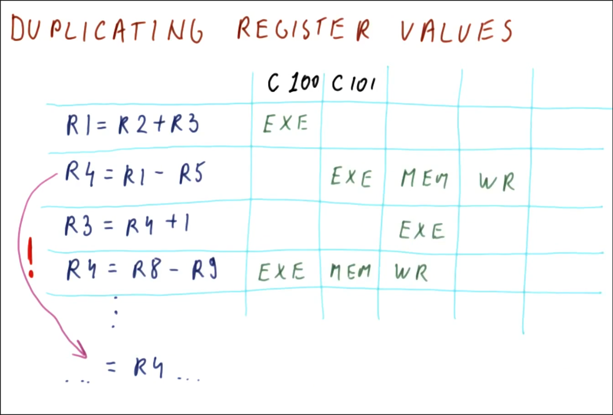

Since false dependencies can be caused by two values using the same register, we can eliminate them by altering the use of registers.

Method 1: Instead of overwriting the register, the processor keeps track of the values that are written to a register. Then the processor can determine which value is the last one produced, which may be different than the last one written. This method is complicated and not really possible.

Instead, use register renaming.

## Register Renaming

Architectural registers are registers that programmers/compiler can access.

Physical registers are all the places that a value can be stored.

The processor uses physical registers to rename the registers in the program to eliminate false dependencies. The RAT (Register Allocation Table) is a table that keeps track of which physical register is linked to which architectural register.
- renames to refer to places where it has actually put those values

## RAT

The RAT is a table that stores the location for the data that would go in an architectural register. This will eliminate name dependencies.

- 0 for r0, 1 for r1...
- fetch -> decodes -> rewrites, for all regs instr needs to read lookup in RAT
    - put result in some new place, not R1, change P1 -> P17 (bc reg getting modified)
- any R4 dependence on the SUB instr gets from P18, any for the last ADD instr gets from P21

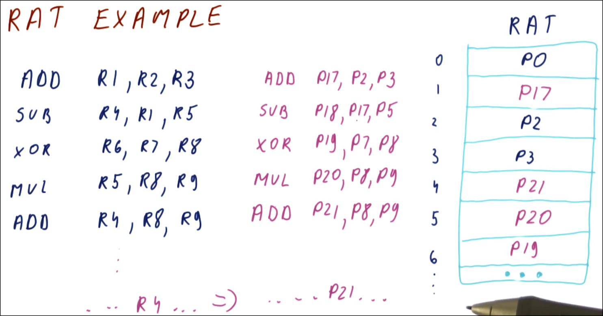

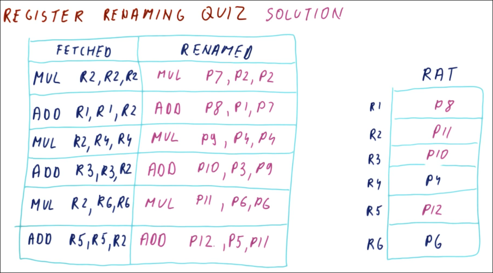

## False Dependencies After Register Renaming

Renaming improves the CPI and IPC.

- RAW/true dependence (in purple)
- WAW/output dependence (in vertical green)
- WAR/anti dependence (in diagonal green)

- for the original sequential program (CPI = 1, IPC = 1)
- for renamed program, no more output and anti dependence
    - can execute the MULs in first cycle, ADDs in the second cycle (6 instr over 2 cycles)
    - 2/6 = 0.33 CPI, 6/2 = 3 IPC

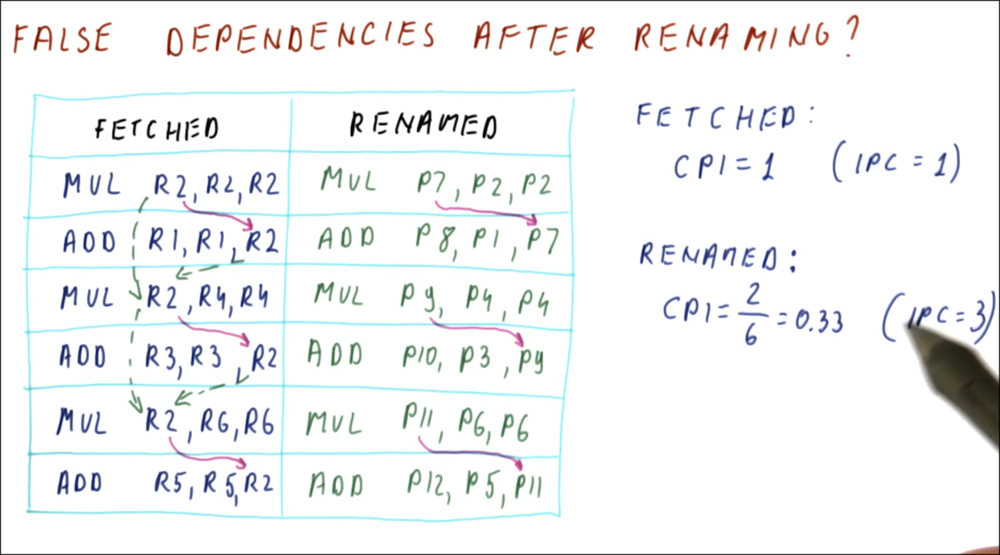

---

## Instruction Level Parallelism

ILP = IPC when:
- the processor can do the entire instruction in 1 cycle and 
- the processor can do many instructions in same cycle. 
    - has to obey true deps

ILP is the property of a program, not of a ps'er. It is based on the dependencies of the program.

### Steps to Get ILP

1. Rename registers as they are used, keeping track of which registers are still free for assignment.
2. "Execute" the program to make sure the false dependencies are removed and determine when the instructions are executed.
3. Then it is the number of instructions / the number of cycles required to execute the instructions.

- didn't need to rename program (only look where true deps are, anti/output are handled)
    - MUL and SUB true dep for P5
- remember how many cycles you're computing (5 instr over 2 cycles = 2.5 ILP)

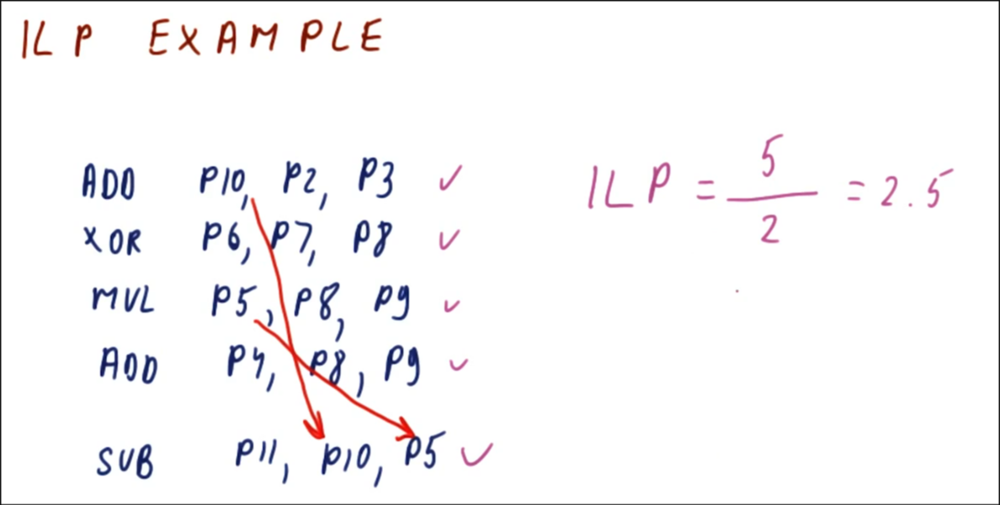

- R2 RAW dep is later than R1 for 3

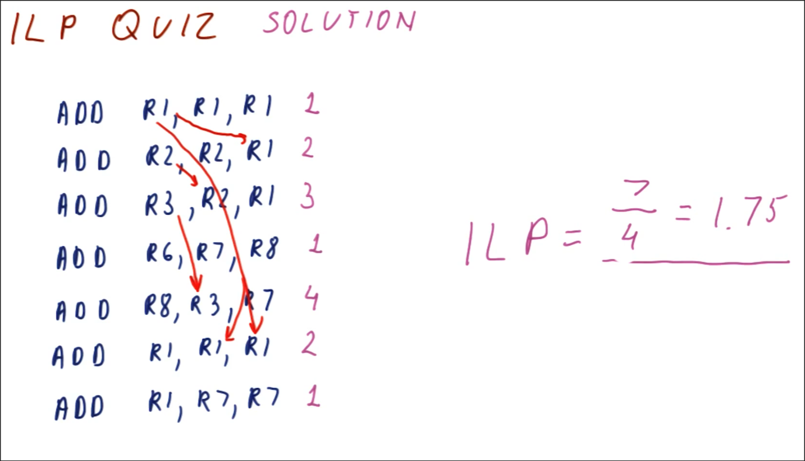

### ILP with Control Dependencies

There are two other types of dependencies; structural and control.

Structural dependencies do not apply to ILP because ILP is based on a perfect processor.
- occurs when we don't have enough hw to do things in same cycle, have to wait on some resource

For ILP and control dependencies, again assume a perfect processor, this time with perfect branch prediction.
- assume perfect same cycle branch prediction
- assume we know branch is taken, goes to Label, since the beginning of the programming although it has ctrl dep from prediction
  - no impact as far as delaying instr following it (i.e. the instr after the Label MUL)

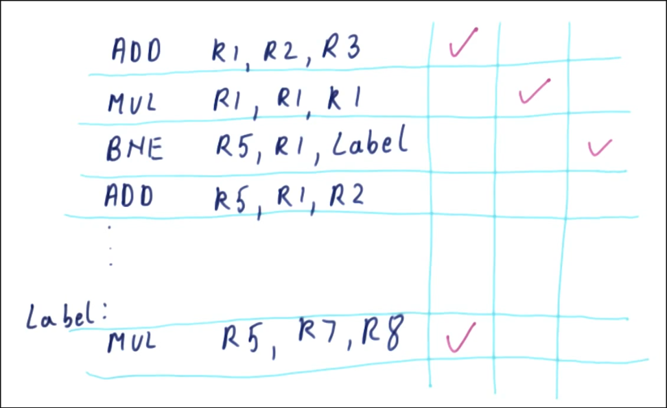

### ILP vs IPC

ILP != IPC, unless ps'er has perfect ps'er doing perfect branch pred only following data deps
- ILP data dep on R1, 2 cycles; 5 instr / 2 cycles = 2.5 ILP ignoring ps'er
- IPC still data dep on R1, can't have more than the MUL/ADD units too
  - assume 3 issue ps'er for example

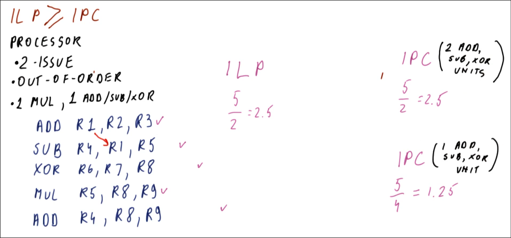

ILP assumes an ideal out-of-order processor with perfect branch prediction that can execute an infinite number of instructions at a time, while the IPC must consider the limitations of an actual processor.

ILP >= IPC

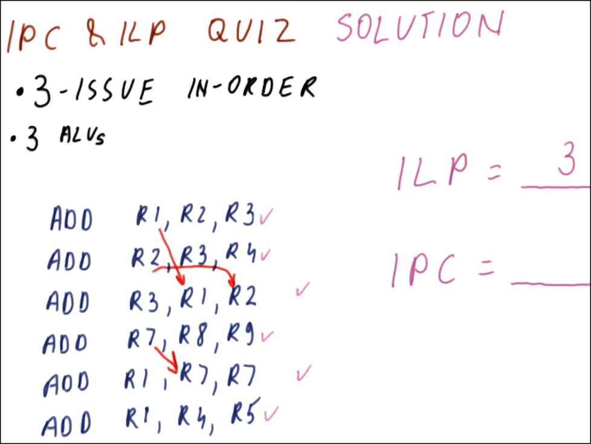

- for IPC worry about 3 issue in order (not ooo) and 3 ALUs

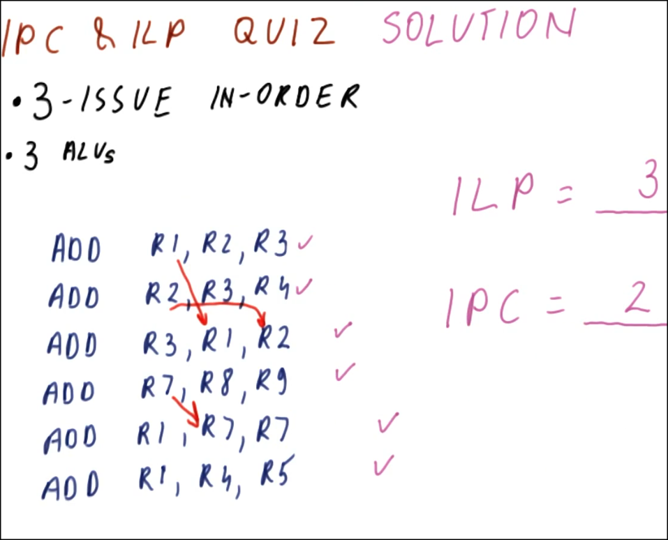

For IPC:
- If the processor is an in-order narrow issue (can only issue ~1-3 instr per cycle) processor, the narrow issue will be more limiting than the fact that it is in-order.
- If the processor is in-order and wide issue, the fact that it is in-order will be more limiting.

Therefore if the processor is wide-issue (capable of issuing 4 or more instructions at a time), it should also be out-of-order.
- benefit from finding instr instead of stopping on deps
It should also be able to eliminate false dependencies and reorder instructions.