# Instruction Scheduling

Hardware implementation of register renaming and out-of-order execution using Tomasulo's Algorithm.

## Improving IPC

- ILP should be at least 4 instructions per cycle (>> 1)
- Control Dependencies are mitigated with Branch Prediction
- WAR and WAW data dependencies are removed with register renaming
- RAW Data dependencies can be improved through out of order execution
- Structural Dependencies can be improved with wider issue processors.

- how to do last 3 in hw implementation?

## Tomasulo's Algorithm

Tomasulo's algorithm determines which instructions have inputs ready for execution, it uses a form of register renaming, and it is very similar to the method used today.

The differences between what is used today and Tomasulo's algorithm are:

1. All instructions use the algorithm, not just floating point ones.
2. Hundreds of instructions are considering when performing out-of-order execution and register renaming, not just a few.
3. There is now support for exception handling.

1. instruction queue (IQ), instrs come in fetch order
2. put instr in reservation station (RS) when one becomes available
   - instr sit for param to become ready
3. when instr inserted into RS, vals present in regs entered into RS from floating point REGS file
4. instr ready to execute goes to execution  unit (ADD, MUL, etc.)
5. res broadcast on bus, going to REGS file and also RS (for instrs waiting for vals to be produced)
   - typically 2 per RS since generally uses 2 operands
      - either or both operands might need result, otherwise ignore
6. if instr not arithmetic (load/store), go to ADDR generation unit to compute addr
   - insert instr into load buffer (LB) or store buffer (SB) to be queued up to go into mem
      - LB provides addr, SB provides data and addr
   - comes back from MEM, val broadcasted on bus for REGS and into SB too
   - done in order, arithmetic is ooo

- issue: send instr from IQ -> RS
- dispatch: send instr from RS -> execution station
- write result (broadcast): instr ready to broadcast result

## Instruction to Broadcast Path

Data Manipulation Path:

Instruction Queue → Reservation stations (values come from the registers) → Execution Units (Adders and Multiplier) → Broadcast on the Bus

Load/Store Path:

Instruction Queue → Adder (for PC) → Load or Store Buffer → Memory → Broadcast on the bus

Issue = instructions exit the queue and go to either the RS or the PC-Adder.

Dispatch = Instruction exits RS and goes to either the Adder or the Multiplier for execution.

Write Result or Broadcast = the instruction exits the Adder or the Multiplier and is put on the bus.

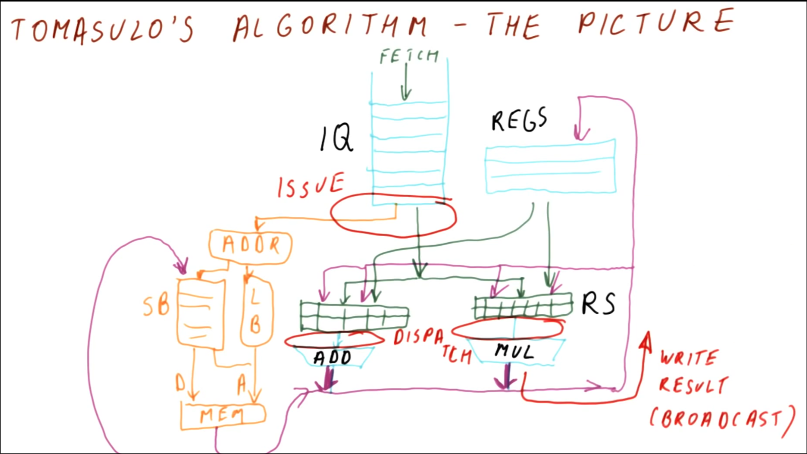

## Issue

1. Next instruction from the IQ - instructions are issued in program order (for reg renaming)
2. Determine origin of inputs
   - in reg file or produced by instr that haven't broadcasted res
3. Get free RS of the correct kind - if there are no free RS, the instruction needs to wait for an open RS.
4. Put instruction in the appropriate RS
5. Tag the destination register - this register will hold the result of the instruction and all other instructions will be able to access this result if necessary.

### Issue Example

Steps for Issue

1. Take instruction from IQ
2. Look in the RAT
   - for each floating point reg, look in register alias table (RAT) which keeps instr produces which reg
      - if RAT has a value for the register - use the register pointed to
   - if RAT does not have a value - look in the register file (RF)
3. Reservations Stations - some are adders and some are for multipliers
   - if an RS is open - use it
   - if an RS is not available - wait for one to be open
4. Store in the RAT the register that holds the result of the instruction.
   - future instr that want F2 will wait for res of RS1, won't read F2 from RF
   - result for F1 coming from RS4 for second instr
   - result for F4 coming from RS2
   - for 4, F1 already renamed for RS4
      - override with RS3
      - in real ps'er some of those instr could've executed during the time but this for example

- say there wasn't issue slot for RS3, cannot issue that instr for 4

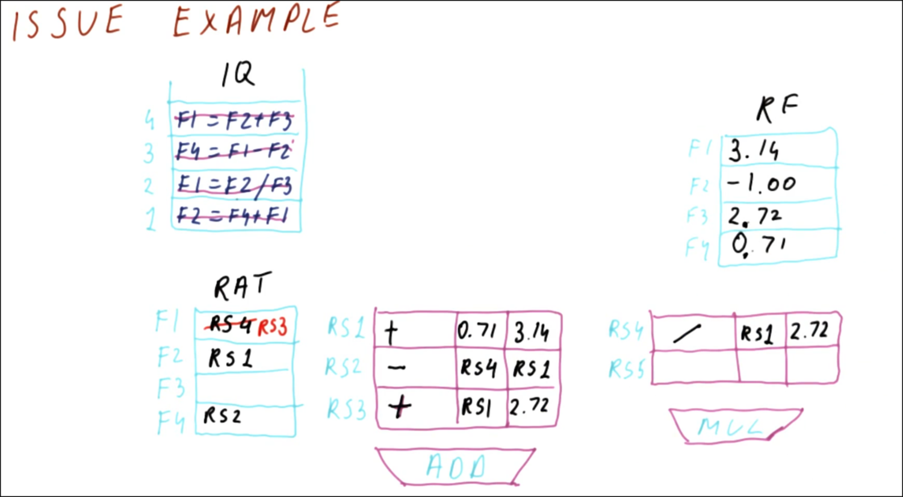

- F4 can't be issued bc RS for MUL full, issue stalled

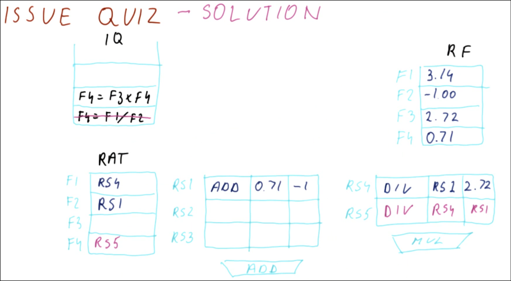

## Dispatch

Dispatch needs to latch the results produced and determine which instructions are ready to execute.

- RS dispatched RS1 -> broadcast res -> which RS producing res and what val
1. Free the RS (RS1)
2. Match the broadcast tag with the operations in the RS
3. Insert the value in the appropriate RS from the res
4. Once an RS has all of its required inputs - it can execute in the Adder or the Multiplier.
5. When the result is ready from the Adder or the Multiplier, broadcast it on the bus.

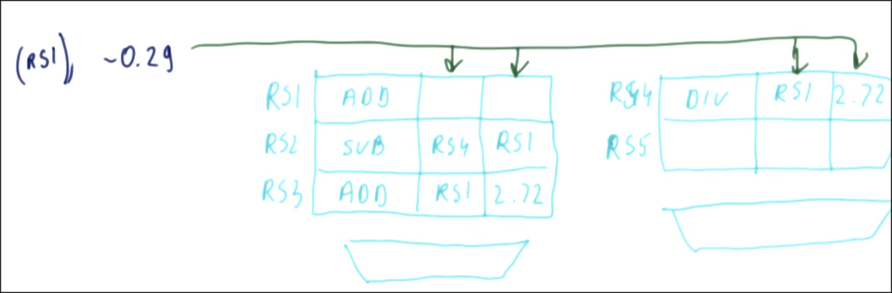

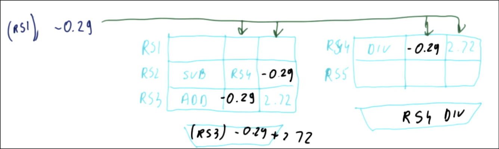

### If more than 1 instruction is ready to Broadcast

Which instruction should be dispatched first.

- Can choose the oldest instruction first (could have seen more instr depending on it) (easy to do, compromise)
- The instruction with the most dependencies goes first (how many instructions are waiting for this result) - this is difficult to implement in hardware (for search) (best)
- Random selection (worst)

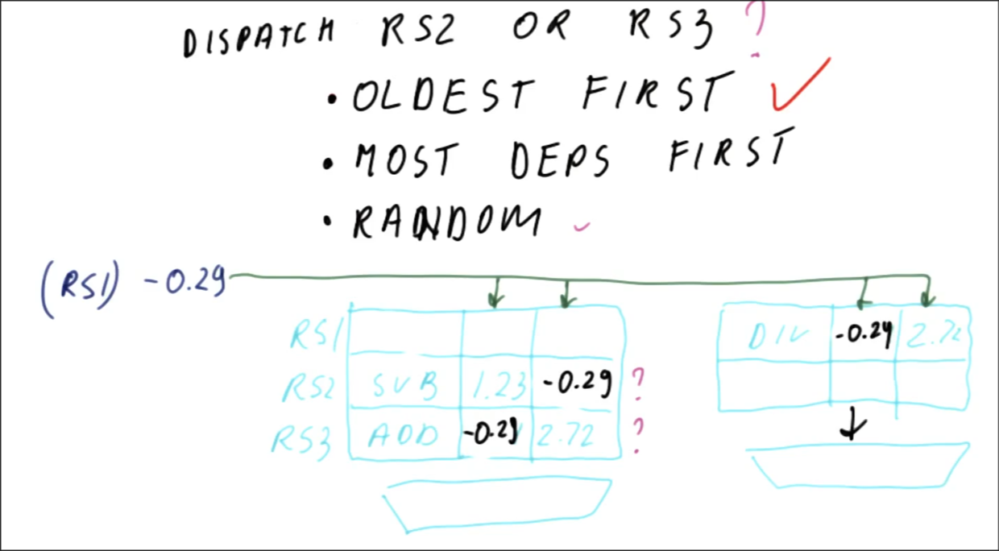

- if RS3 came into RS in prev cycle, might've not been enough time for selection + dispatch in same cycle
- RS1 could've been sent in prev cycle to add unit and add unit can only take 1 instr
- tomasulo dispatch when operands ready, and ooo execution for arithmetic

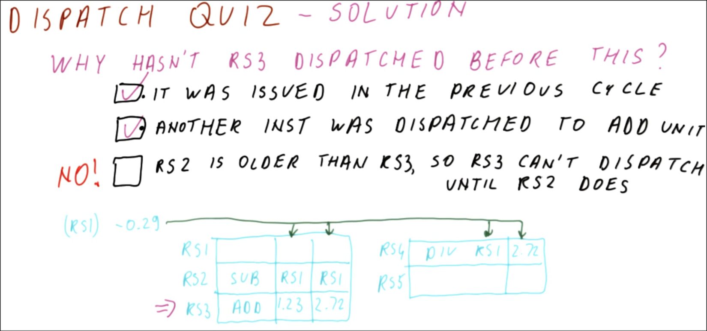

## Broadcast

1. Put the tag and the result on the bus.
- tag (RS1) and res (-0.29) on bus
2. Write the result to the register file.
- overwrite F2 with -0.29 bc of match with RAT for RS1
3. Update the RAT. An empty RAT entry means the value is ready in the register file
4. Free the reservation station (change the valid bit)

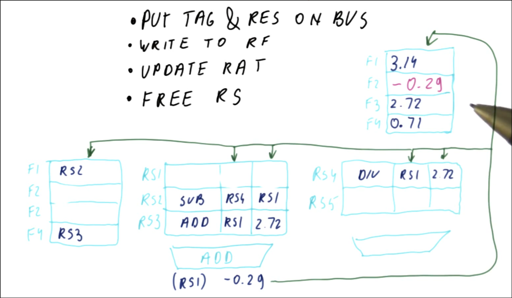

### What if there is More the 1 Broadcast Ready?

How to decide which result is broadcast first?

1. A separate bus for each arithmetic unit - this increases the hardware needs
   - separate bus = twice as many comparators for matching in each RS = writing res to RF, etc.
2. Give priority to the slower unit - the slower unit instructions will most likely have more dependencies.
   - The multiplication/divide unit takes more cycles to complete - so it is usually given priority.

### Broadcasting a Stale Result

A result is stale if it no longer has an entry in the RAT.
   - RS4 not in RAT
      - could happen if F4 was renamed to RS4, another instr came (RS2) and writing to F4, so RAT F4 -> RS2
   - filling RS as normal

A stale result is broadcast and placed in the appropriate RS entry. The RAT (and RF) is not altered because any future instructions will not use this value.
- any instr that would need it already in RS, which we update
- would use newest renamed value for F2 (RS2)

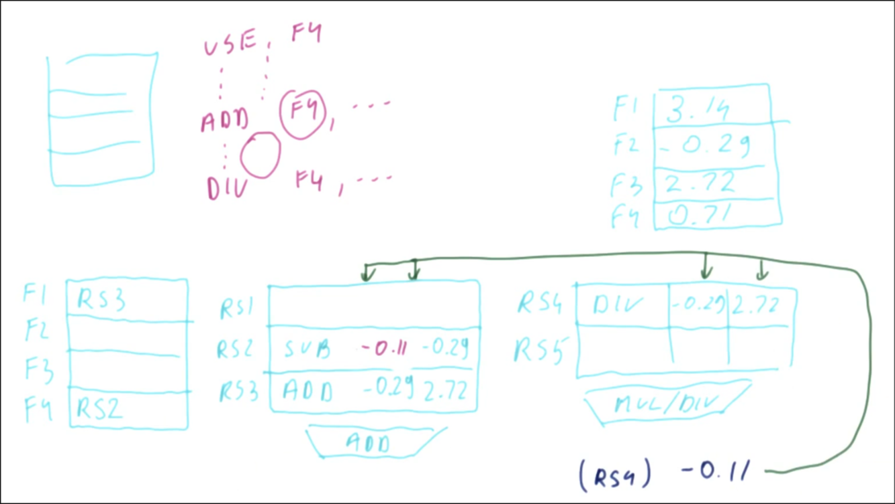

Remember this on Midterms and Finals

## Review

For each instruction:
- Issue
- Capture (fill in operands from res until all populated)
- Dispatch
- Write Result
   - updates RF, empties RAT so future instr reads from RF

In each cycle (at the same time) done by the ps'er for all instr
- Issue
- Capture
- Dispatch - one for each arithmetic unit
- Write results for different instructions -> for capture instr

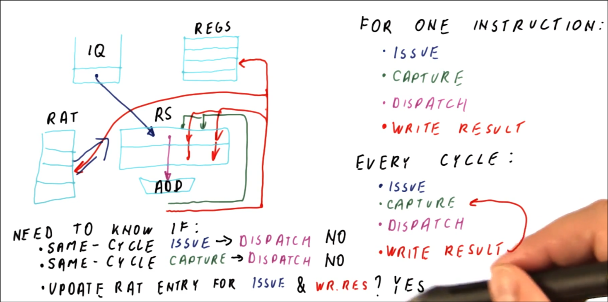

Can an issue and dispatch be done in the same cycle? It depends on the processor.

Issue time is shorter than the cycle time, so there can be time to do the dispatch. But the cycle should be as short as possible, so it should not be feasible.
- also need to test RS before dispatching

Capturing operands and dispatching should not be done in the same cycle.
- updates status from operands missing -> ready, but would need more hw to do same cycle

Broadcasting and issuing to the same RS can be done in the same cycle but it requires additional logic to work (if both in same cycle, just write the issue).
- issue instr update RAT to change entry for its dest operand (ensure val kept, point following instr to its RS)
- broadcasting instr update RAT to correspond to dest operand (empty RAT entry to point others to RF)

- What is in REGS/RAT entries after the cycle?
   - issue: F1 entry changed to RS2
   - broadcast: F0 RS0 cleared, point to RF 4.4 because RAT had RS0 entry

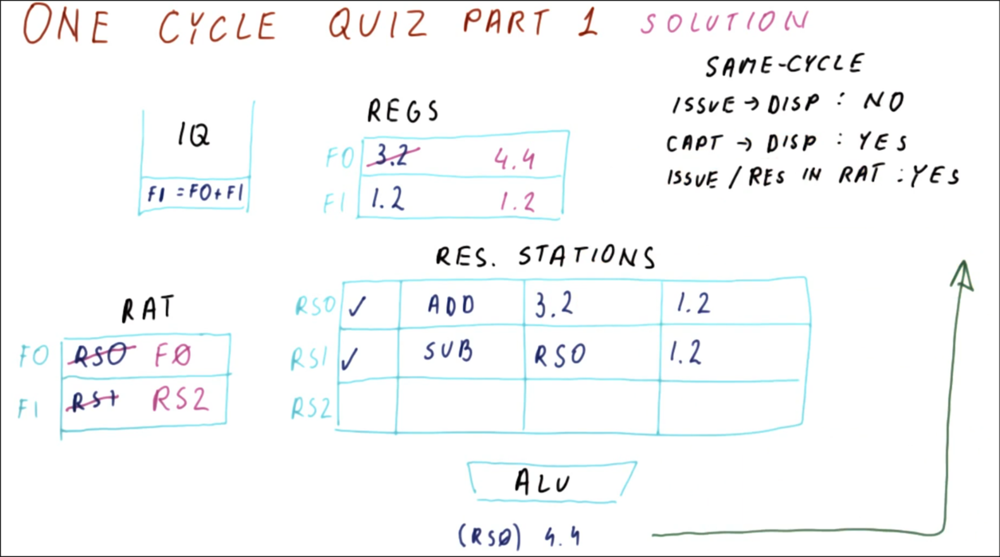

- what is in RS at end of cycle?
   - issue: for the add
   - broadcast: free RS0, update RS1 and RS2

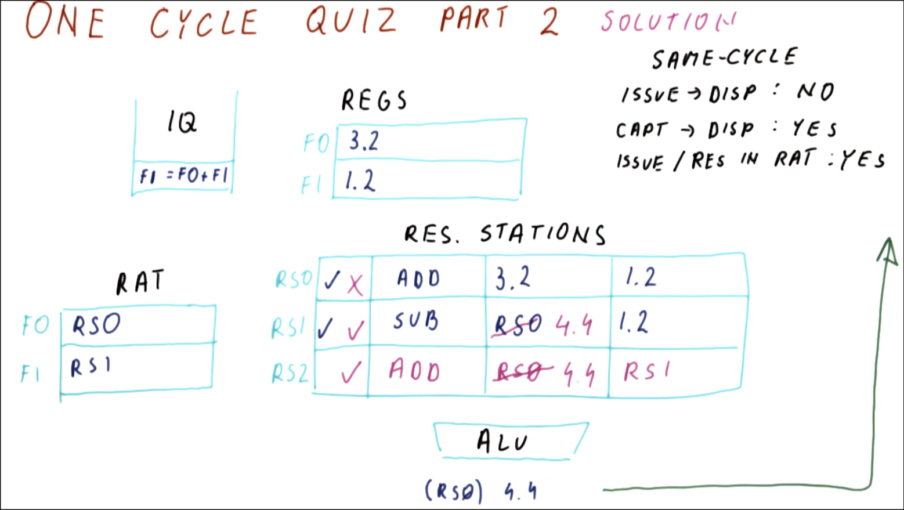

- which instr dispatch this cycle?
   - RS1 captures RS0, CAPT -> DISP allowed so will dispatch

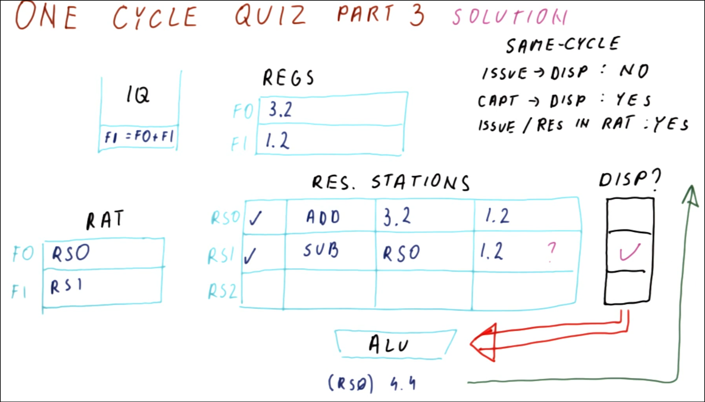

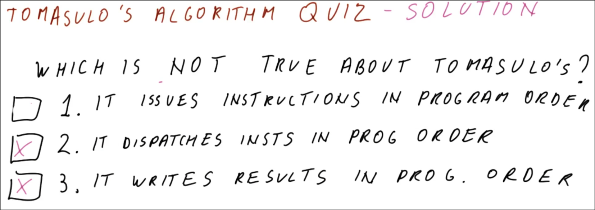

## Load and Store Instructions

There can be data dependencies through memory.

- RAW occurs when a store word to a memory location occurs after a load word of that same memory location.
   - SW to A, then LW from A
- WAR occurs when a load word to a memory location occurs after a store word.
   - LW then SW
- WAW occurs when there are two store words to the same memory location.
   - SW, SW to same addr

These need to obeyed or eliminated by;

- Doing loads and stores in-order in Tomasulo L/S queue (i.e. load doesn't execute if store pending)
- Identify dependencies and reorder - this is done in modern processors, but not in Tomasulo's algorithm.

- Vj/Vk are operands, Qj/Qk are what we're waiting for

- cycle 1
   - LD adds 34 to R2 (100) = 134 for addr (done by addr unit not ALU, immediate)

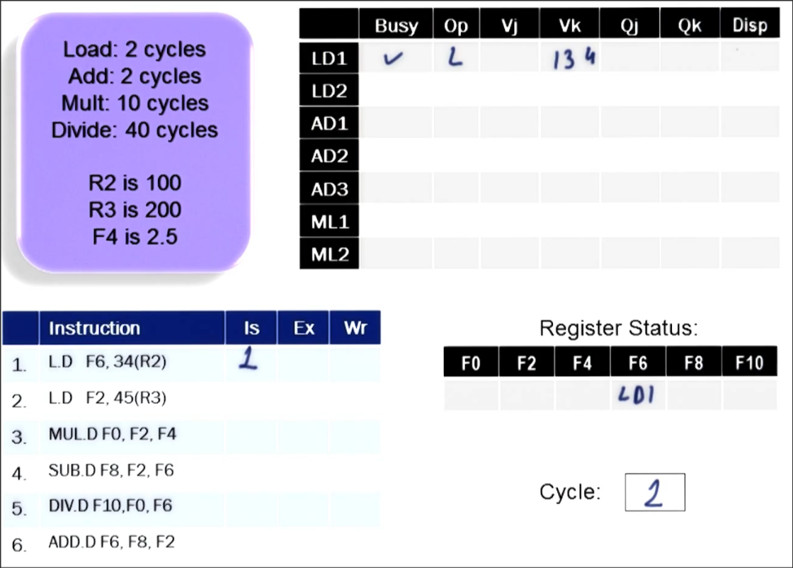

- cycle 2
   - fetch for LD2, rename F2 to LD2
   - dispatch LD1, ex done in cycles 2/3, wr done in cycle 4

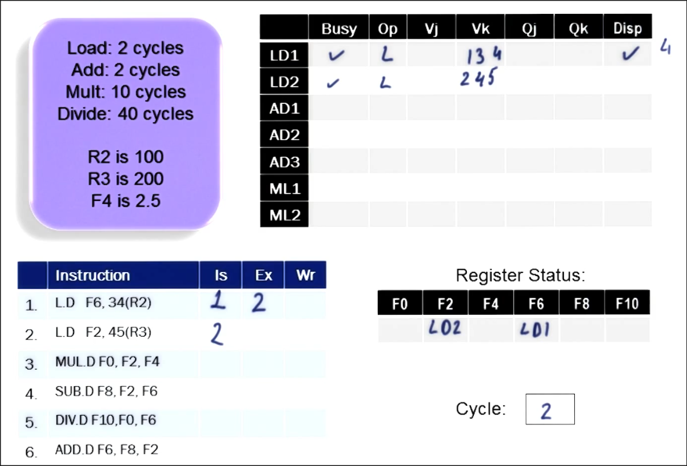

- cycle 3
   - fetch for ML1, rename F0 to ML1
   - LD1 still executing, say load unit not pipelined so can't dispatch LD2 until cycle 4

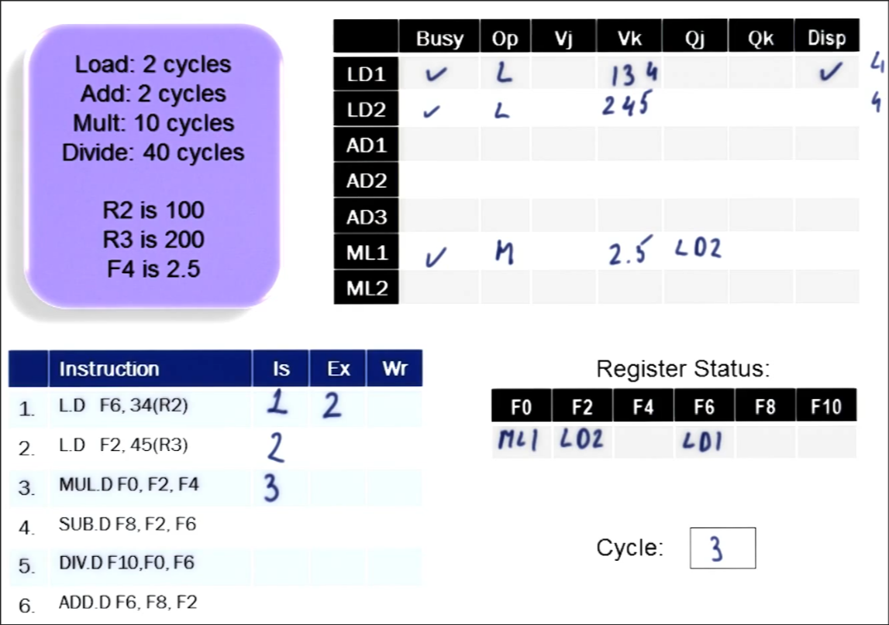

- cycle 4
   - fetch for AD1, rename F8 to AD1
   - dispatch LD2
   - write res for LD1, update AD1 (say val 7.1)
      - clear RAT for F6, put 7.1 in
      - clear LD1 (i.e. mark bit)

- cycle 5
   - fetch for ML2, get F6 from RF, rename F10 to Ml2

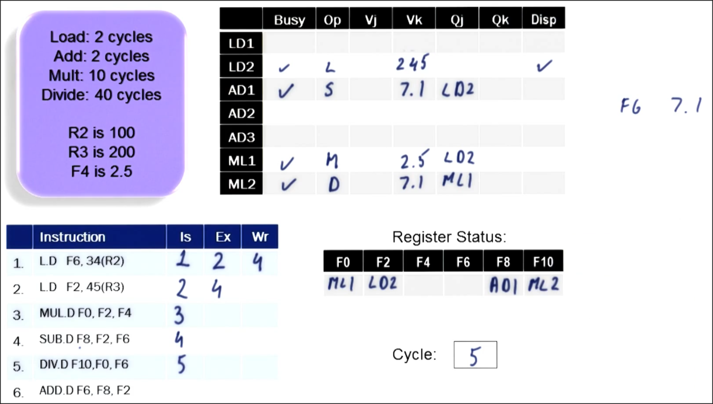

- cycle 6
   - fetch for AD2, rename F6 to AD2
   - write res for LD2 (F2 = -2.5), update AD1, AD2, and ML1
   - bc F2 in RAT matches LD2, clear RAT and update RF, clear RS for LD2
   - think dispatch -> issue -> write in order

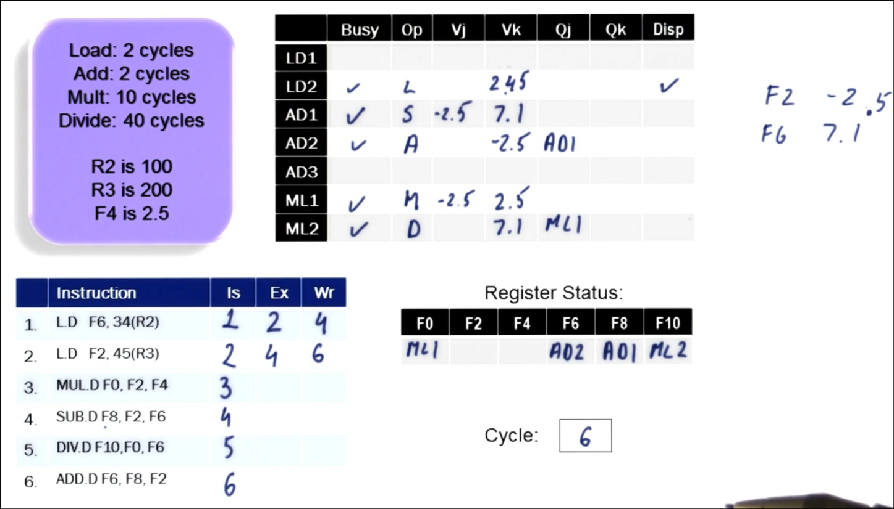

- cycle 7
   - can dispatch AD1 and ML1, diff units so can dispatch in same cycle

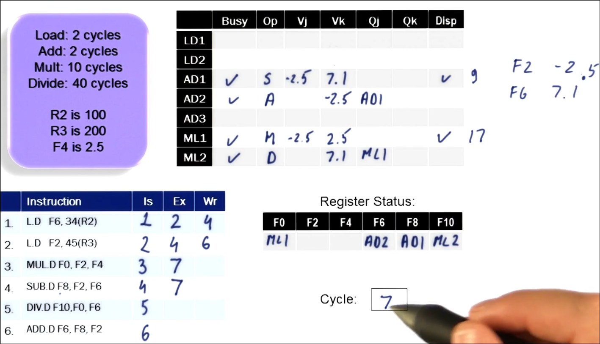

- cycle 8 -> cycle 9
   - AD1 broadcasts, write val to F8 in RF since it's in RAT and clear it
   - update AD2
   - free RS

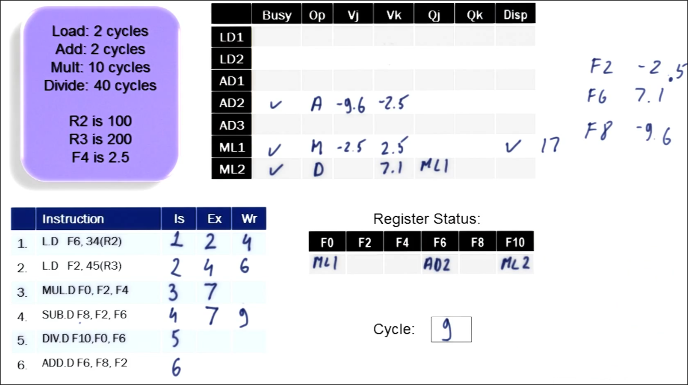

- cycle 10
   - dispatch AD2

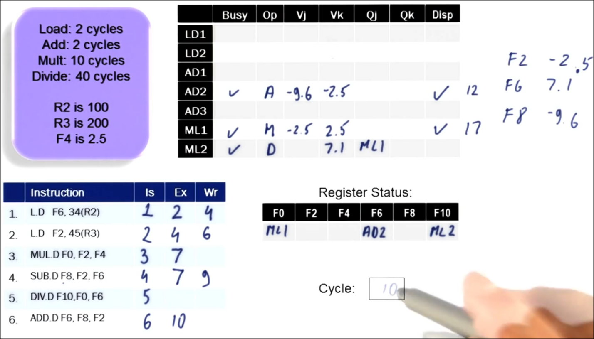

      - writes in cycle 12, overwrite F.6 with -12.1 in RF and clear in RAT, clear RS

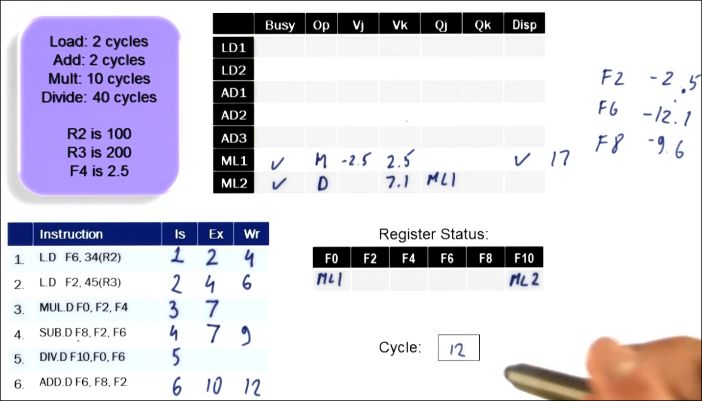

- cycle 17
   - write F0 in RF, clear RAT, clear ML1, update ML2

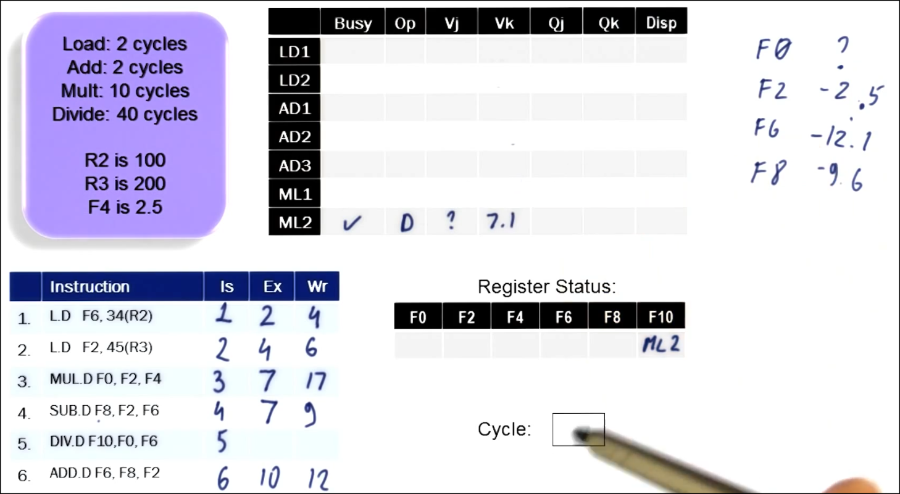

- cycle 18
   - dispatch ML2, write in cycle 58, write F10 in RF, clear RAT, clear RS

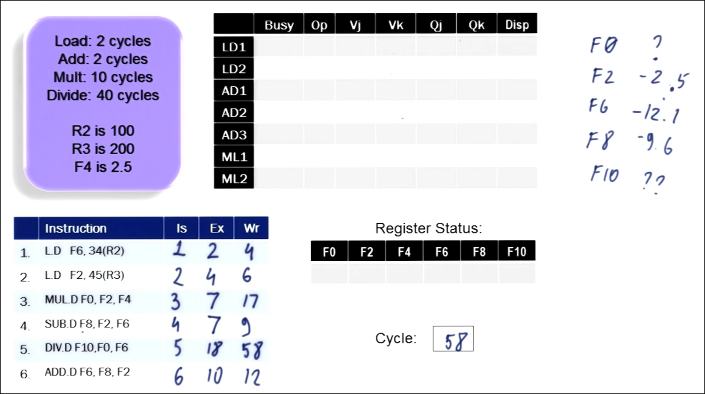

## Timing Example
- assume load can't overlap
- 3 has to wait until 7 for 2 for F2
- 4 waits for later of two deps, so F2 until 7
- assume 2 RS for MUL/DIV
- 5 waits for 3 until 18 to ex
- 6 waits for later of two deps, so F8 at 4

- check if any writes on same cycle, if so have to redo

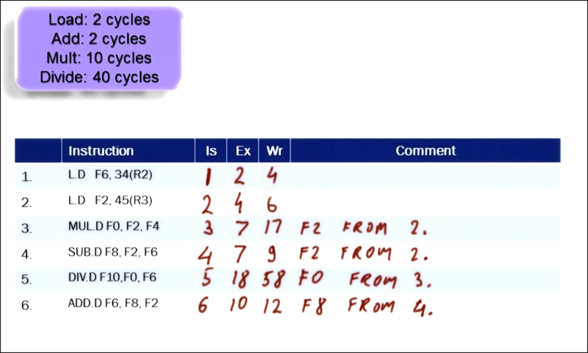

- figure out for 1-4 instr when do they disp and write res
- if RS freed, only eligible for another instr in next cycle
- 3 needs F2/F6, F6 in 8 and can't capture -> dispatch, so wait until 9
- 4 needs F2/F6, latest F6 from 3 so wait until 11

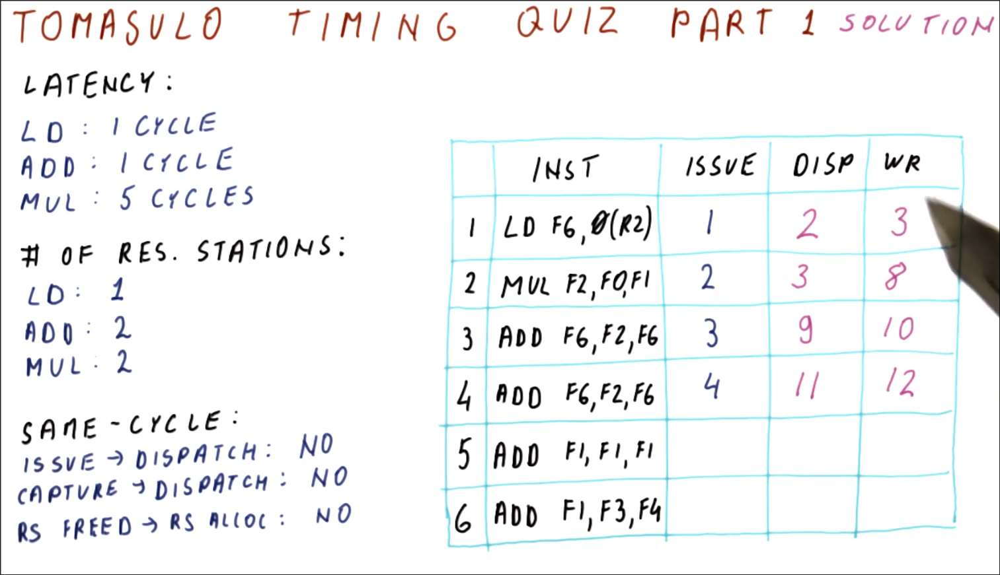

- figure out for 5-6 instr when do they disp and write res
- for 5, the 2 adds are taking up the RS and needs to be freed a cycle after since RS freed -> RS alloc is no
   - issued in cycle 11 bc it needs RS freed in 10
- for 6 in 12, 4 and 5 still holding RS
   - issued in cycle 13

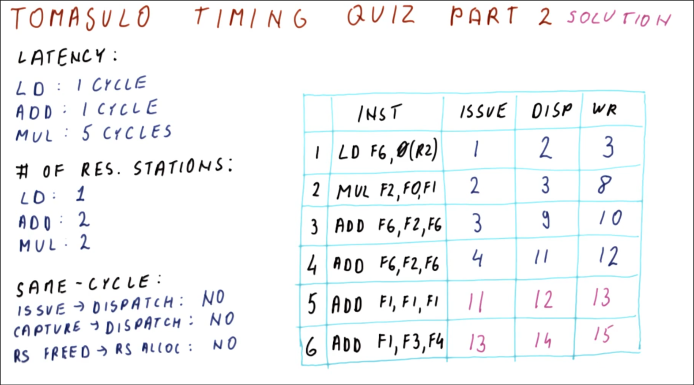