# Memory Ordering

Out of order processing can lead to better performance, as long as the results of the program are correct. Which means ensuring the correct handling of dependencies.

- Control dependencies are eliminated using Branch Prediction
- False dependencies are eliminated using Register Renaming
- Register dependencies (RAW) are eliminated using Tomasulo-like scheduling with RS

- data dep handling only for register deps

This lesson discusses a method for handling memory dependencies, the Load/Store Queue.
- e.g. dep between mem val written by the store and the load, if two addrs are the same

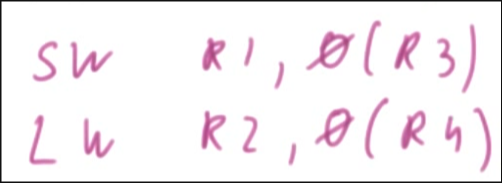

## When Does Memory Write Happen

Writes to memory occur at Commit for store. 
- If a memory write were to occur before this, it has the potential to be recalled/undo - from an exception or misprediction.

The loads for memory should get the data as quickly as possible.
- use load store queue to supply vals from store to load

## Load Store Queue Part 1

The Load-Store Queue has the following fields:

- A bit for indicating a load or store
- The address of the load or store
- The data value to be stored in memory
- A bit indicating completion

- 1 lw
    - compute addr as 104, since no prev stores go to mem
- 2 sw
    - compute addr as 204, 15 val, mark done
- 3 lw
    - compute addr as 204
    - for every load after computing addr, check lsq if any store matches addr
        - if no match, go to mem
        - if match, do store to load fwding
            - take val from store, that's the val load produces
        - assume store completed at the stl fwding time

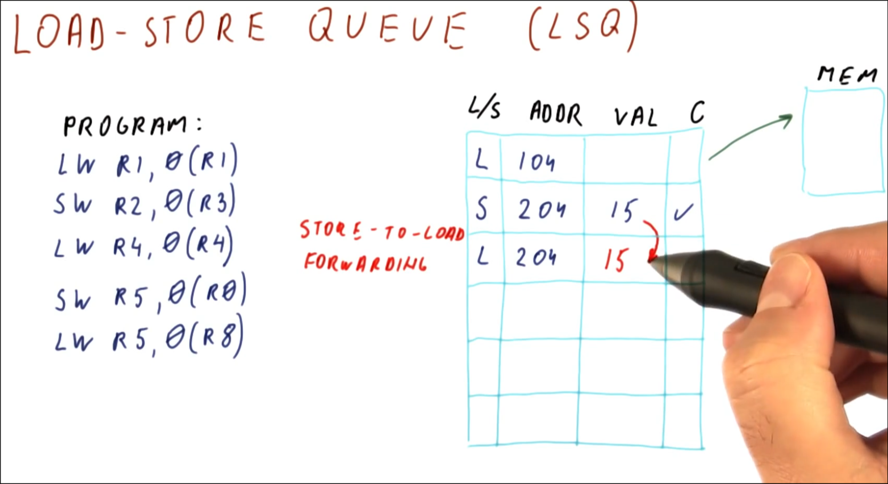

- if sw doesn't have the addr at the time the lw produces the addr, options are:
    - 1. make loads/stores execute in order
        - guarantees all store addr/vals done
        - all instrs have to wait if say, a prior load is going to mem
    - 2. wait for all prev store addrs to be known
        - then compare load addr and either go to mem, get val from store, or wait for store to produce val if addr matches and hasn't completed
    - 3. let load go anyway
        - if one of them matches, wait for it
        - if none, ignore the fact some of them might match after resolving addrs, go to mem
            - if the store resolves to same addr, load loaded wrong val from mem, recover
                - store produces addr -> check if any following loads matches same addr and done -> if so, req redoing of load and subsequent instrs

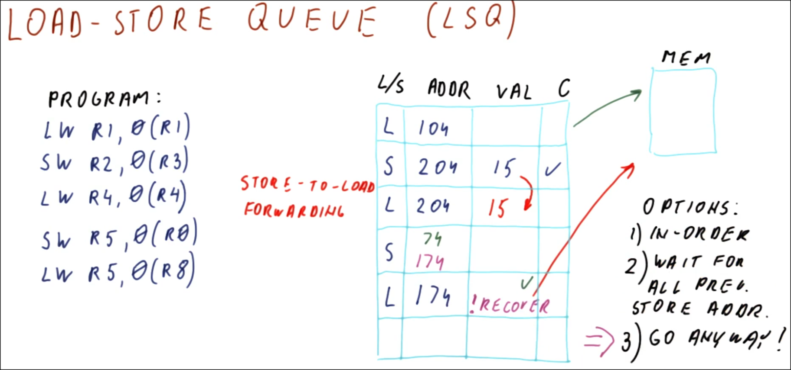

Loads and stores are placed in the queue in program order.

Store-to-Load Forwarding - When a load command is put into the queue, the address of the load is compared to all previous stores in the queue. If there is a match, this value in the queue is used, thus eliminating the need to go to memory.

When a store does not have its address when a load is checking the queue, the following can be done:

1. Wait for the store to get the address, which means perform the stores and loads in order. When the store gets the address, compare it to the address needed by the load and proceed from there. 
- This method is slow and leads to unnecessary waiting.
2. Wait for all previous stores to get their addresses. If any of the stores have the same address as the load, then we know we have to wait for that store to complete. If there is no match, then go to memory to get the data.
3. The most aggressive method is to just go to memory to get the data. If there is not a previous store to that address, this is good. But if there is a previous store to the address, then we have just fetched the old data. A recover will have to be performed.
- To recover the correct data must be obtained - the store instruction will now have the correct data. This data must be propagated to all loads that are accessing this memory address.
- Modern processors use this method because it results in the best performance.

## OOO Load/Store Execution

OOO Load/Store execution occurs when loads go to memory as soon as the address is available.

Sometimes this results in stale data being used and then it needs to be recovered.

- say all instrs fetch/decoded
- instr 1 load
- disp, cache miss (take awhile until load comes back)
- instr 2 and instr 3 need to wait for dispatch
- instr 4 and instr 5 sub can dispatch

- say addr X
    - if r7 (store) addr not same as r1 (load), fine
    - if addr same, r8 should've loaded the r4 val, but instead loading stale from r1 in mem

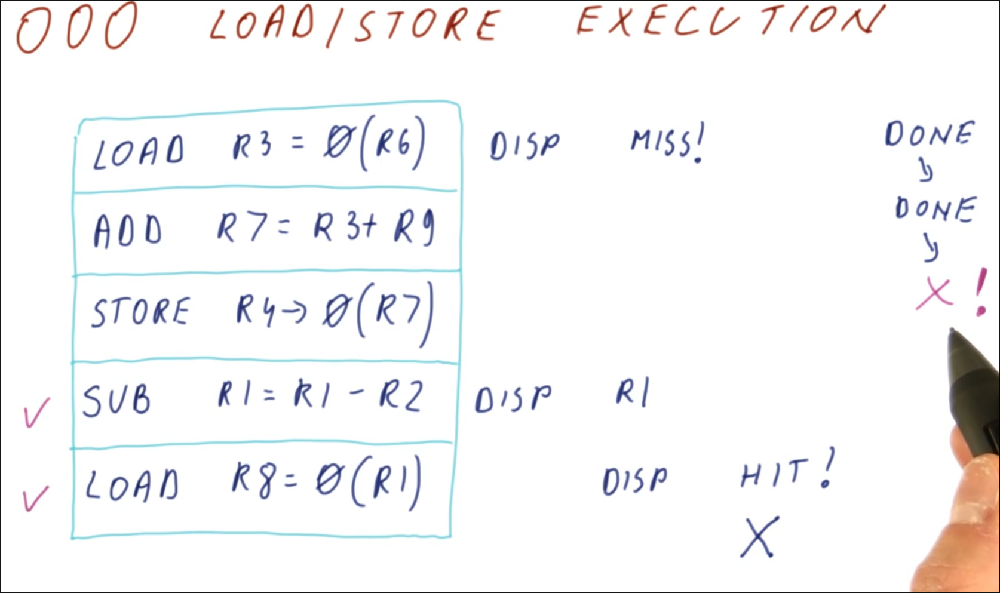

## In-Order Load/Store Execution

To solve the problems of OOO load/store execution, do the loads and stores in-order. 
- A load cannot execute until all previous stores have their addresses. 
- Then the load will check the stores, if there is a match in addresses, the load will wait for the completion of the store. 
    - If there is no match the load will go to memory.

All other instructions can complete out-of-order.

- instr 1 load miss, add/store stalled, sub done, load addr known
    - check lsq if any preceding instr might resolve to same addr (or worse if all preceding instr done)
- eventually instr 1 miss resolved, compute r7
    - then add done, compute store addr with r7 and done
    - at that point, instr 5 load can finish after store finished

This method is not a high performance solution.
- delay following instr for load, and if instr 5 load is a miss have to wait more cycles

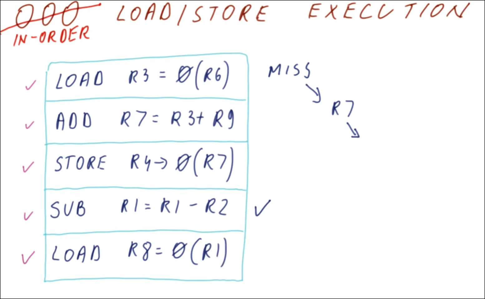

- all loads cache misses
    - send req to mem, 40 cycles later get res
- stores/loads ooo
- stores done at cycle 42, 43, 44
    - 44 cycles to do
- have been doing loads prematurely
    - if r2 + 4 = r3 +0, load should've waited for instr 2/3

- when instr sent to mem and when we get res from mem if load/store in order

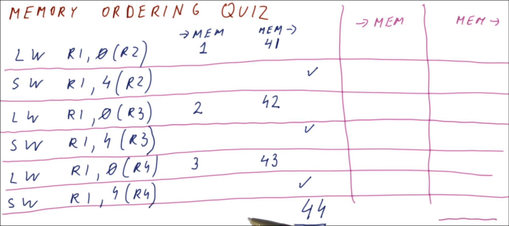

- stores done cycle 42, 84, and 126
    - almost 3x diff when doing in order, but ooo has risk of recovery from incorrect loads from mem instead of store

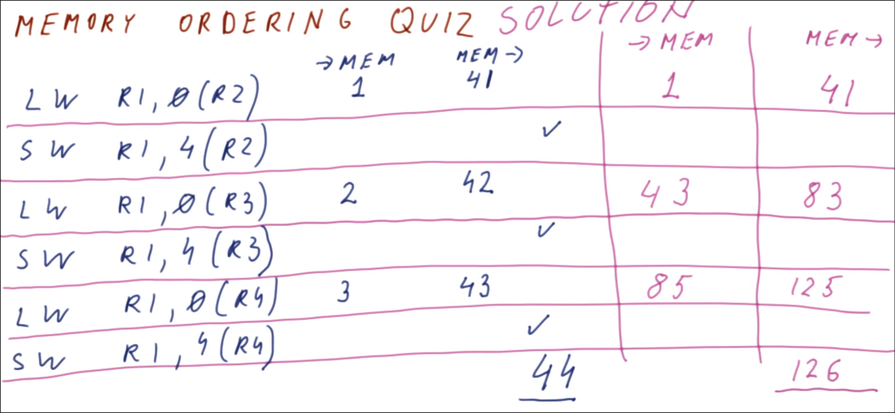

## Store to Load Forwarding

Two questions that need to be answered:

1. A load instruction asks: Which earlier store has the required value?
    - if none matching go to mem
2. A store instruction asks: Which later load(s) will need this value?
    - could be multiple loads to give vals to

These answers can be found in the load/store queue (LSQ).

The values must be written to memory or data cache when the store is committed - not when it executes.

- lsq storing instr in pgrm order, addr load/store fetched from, seq num going up, addr load/store resolves to, val for load/store + content of data cache

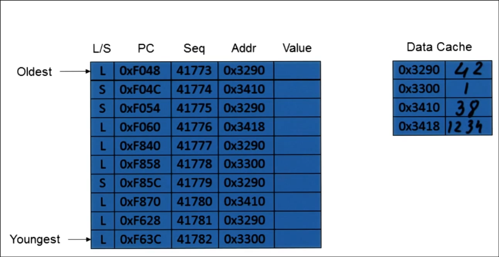

- 1. accesses 3290 from dc, gets 42
- 2. store computes result (gets val to store), gets 25
    - doesn't put in dc yet, only at commit
...
- 4. load tries to see if any prev store matches 3418 addr, no, get from dc
- 5. load searches prev stores, finds store 3, copy its val
- 7. store to 3290, gets 0
...
- several stores to 3290 now, always want to get val from closest store preceding us
    - but dc still contains 42, although there have been modifications bc haven't committed yet

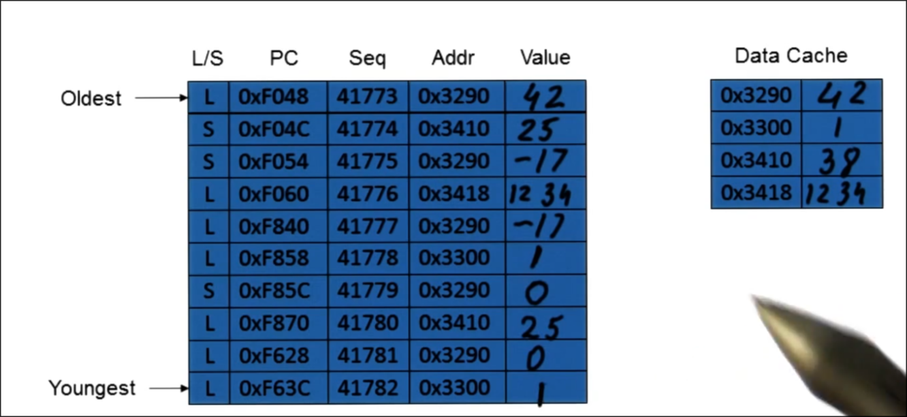

- loads/stores starts committing, increment oldest ptr
    - load copies val to rf
    - store puts val in dc
        - do at commit, not execute
            - if we decide to take exception, flush lsq, vals in dc in mem are exactly vals that should be there at that (commit) point in pgrm execution

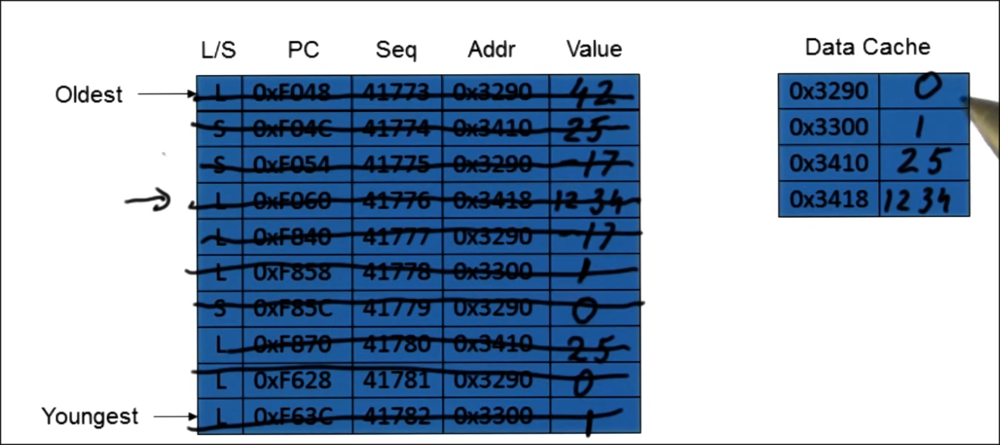

## LSQ, ROB, RS

When issuing a Load/Store instruction, there must be a:

- ROB entry available
- LSQ entry available (basically RS for load/store)

When issuing a non-Load/Store instruction there must be a:

- ROB entry available
- RS available

When executing a Load/Store Instruction

- Compute the address
- Produce the value
    - load: get the addr then get val from store/cache/mem
    - store: compute/produce in any order
- Write the results for Loads, which will broadcast it to waiting rs.

Commit the Load/Store

- Free the ROB entry
- Free the LSQ entry
- For the store - send the value to memory (write to mem)

When there is a Store then a Load to the same address - the data value is supplied by the LSQ.

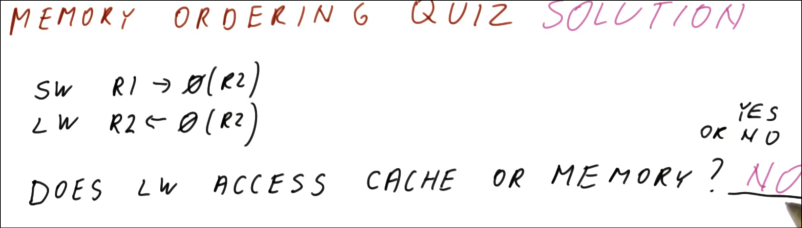

- might be possible for multiple answers
    - where does store keep val?
        - store doesn't broadcast res, only for reg results
        - rs don't provide res to instr, only keep vals for current instr + store doesn't have rs
        - store isn't reg value producing instr, doesn't put res in rob (technically doesn't have a res)
        - store keeps vals in lsq

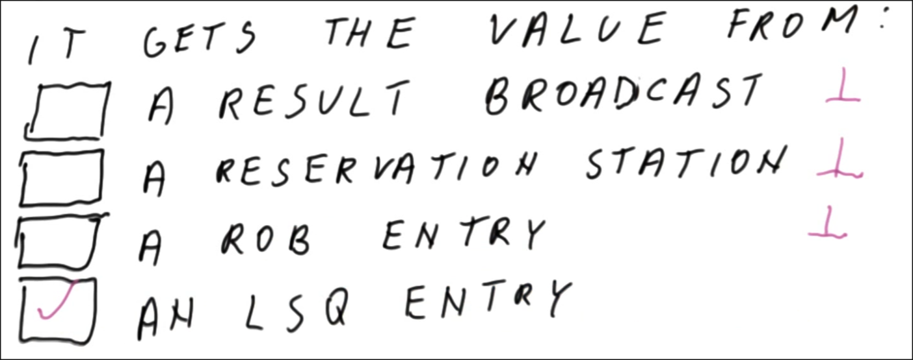